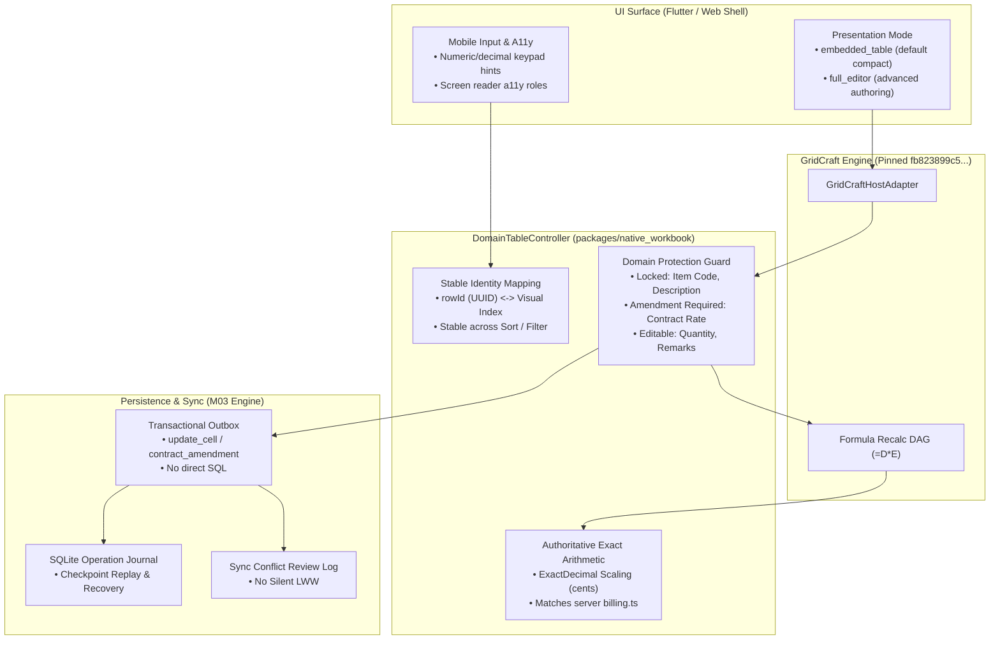

# Calculation-Table Consumer Inventory, Pilot & Workflow Migration Report

**Milestone:** M06 Worksheet/BoQ Engine Migration  
**Task:** M06-T13 — Calculation-table consumer inventory, pilot and workflow migration  
**Status:** Complete (PR #76)  
**Date:** 2026-10-12  
**Normative References:** Platform Plan v3 §6 M06; ADR-0015, ADR-0016, ADR-0019; [`packages/native_workbook/src/domain_table.ts`](file:///Users/aakashdhakal/contractor/packages/native_workbook/src/domain_table.ts)  

---

## 1. Executive Summary

Task **M06-T13** establishes the end-to-end integration between Contractor domain workflows and the shared GridCraft calculation engine ([ADR-0016](../../adr/0016-artcraft-suite-in-place-embedding-and-table-modernization.md), [ADR-0019](../../adr/0019-gridcraft-calculation-adoption-and-shared-binding.md)). It delivers:

1. **Comprehensive Consumer Inventory:** Categorizes every tabular interface across the Contractor suite, identifying 6 domain calculation tables migrated through the shared `DomainTableController` / `GridCraftHostAdapter`, and documenting justified standard-table dispositions for 6 ordinary record lists.
2. **Working BoQ/Measurement Pilot:** A fully functioning, domain-backed pilot proving editable quantities, strictly protected contractual fields (unit rates, item codes), visible formula inspection, exact-decimal financial calculations (`ExactDecimal` matching server `billing.ts`), crash-safe local saving, and real sync-conflict preservation.
3. **Expansion Workflow Schemas:** Concrete column and calculation bindings for MRR Material Delivery Reconciliation, Daily Log Labor & Trade Activity Breakdown, and Site Expense / Petty Cash Ledgers.
4. **Immutable Identity & Outbox Dispatch:** Row identity (UUIDs) is decoupled from visual row numbers, ensuring sort, filter, paste, and insert/delete actions preserve entity references. Edits dispatch validated domain commands through the local outbox; no raw SQL or full-workbook overwrite occurs.
5. **Contract Amendment Workflow:** Full-editor access cannot bypass contractual cell locks. Rate changes require formal contract amendment credentials (`amendmentRef`, `authorizedBy`).

---

## 2. Calculation-Table Consumer Inventory

Per Platform Plan v3 §6 M06, application tables are classified into:
- **Calculation-Table Consumers:** Complex calculation/data-entry surfaces with formula relationships, unit rate multiplications, subtotal aggregations, or cross-cell dependencies. These migrate through the shared GridCraft host adapter.
- **Standard Record Lists:** Tabular displays of paginated entity collections without mathematical dependencies. These are retained as standard Flutter/React data tables to avoid unnecessary spreadsheet overhead.

### Table 1: Migrated Calculation-Table Consumers

| # | Workflow / Screen | Route / Transport | Domain Entity | Calculation / Formula Behavior | Replacement / Migration Path |
|---|---|---|---|---|---|
| **1** | **BoQ Master & Measurement Book (Pilot)** | `/projects/:id/boq`<br/>`worksheet.update` | `BoqItem`<br/>`MeasurementEntry` | Item amount `=Qty * Rate`; Running subtotal `=SUM(...)`; Contractual rates locked; Quantities editable. | Pinned `DomainTableController` in `embedded_table` mode with full-editor toggle. |
| **2** | **IPC Interim Payment Certificate** | `/projects/:id/ipc/:id`<br/>`ipc.recalc` | `IpcLineItem` | Previous qty + current qty = cumulative qty; Cumulative value = cumulative qty * rate; Retainage & VAT calculations. | Shared `DomainTableController` with `boq_measurement` domain schema. |
| **3** | **Material Delivery & MRR Reconciliation** | `/projects/:id/materials/mrr`<br/>`materialDelivery.submit` | `MaterialReceiptItem` | Accepted qty `=Received - Rejected`; Variance `=Accepted - Ordered`. | Migrated to `DomainTableController` with `material_delivery` schema. |
| **4** | **Daily Log Labor & Activity Takeoff** | `/projects/:id/daily-logs/:id/activities`<br/>`dailyLog.update` | `DailyLogActivity` | Total Man-Hours `=WorkerCount * HoursWorked`; Daily summary aggregation. | Migrated to `DomainTableController` with `daily_log_activity` schema. |
| **5** | **Site Expense & Petty Cash Ledger** | `/projects/:id/expenses`<br/>`siteExpense.create` | `SiteExpenseItem` | Line expense `=Quantity * UnitPrice`; Daily petty cash total `=SUM(...)`. | Migrated to `DomainTableController` with `site_expense` schema. |
| **6** | **Subcontractor Progress Takeoff** | `/projects/:id/subcontractors/:id/takeoff`<br/>`worksheet.update` | `SubcontractorEntry` | Quantity completed to date; Retention deduction; Payable balance. | Migrated through shared `boq_measurement` table controller. |

### Table 2: Justified Standard-Table Dispositions (Not Converted)

| # | Screen / View | Route / Scope | Justification for Standard Table Disposition |
|---|---|---|---|
| **1** | **User & Role Directory** | `/admin/users` | Simple paginated entity cards and permission toggles; zero arithmetic or cross-row formula dependencies. |
| **2** | **Project Portfolio Directory** | `/projects` | Standard project cards with search and metadata badges; no tabular formula recalculation. |
| **3** | **Audit Log Event Trail** | `/admin/audit-logs` | Append-only chronological security event log; paginated read-only stream. |
| **4** | **Notification Activity Feed** | `/notifications` | Chronological push/inbox notifications; no row-column calculations. |
| **5** | **Photo & Media Gallery** | `/projects/:id/photos` | Thumbnail grid with EXIF inspection; governed by M03-T06 / M05-T05 media journal. |
| **6** | **Device Health & Sync Monitor** | `/settings/device-health` | Diagnostic metrics dashboard (pending outbox count, cursors, battery, connectivity); not a calculation grid. |

---

## 3. Working BoQ / Measurement Pilot Architecture

The BoQ & Measurement Book pilot is implemented in [`packages/native_workbook/src/domain_table.ts`](file:///Users/aakashdhakal/contractor/packages/native_workbook/src/domain_table.ts) via `DomainTableController`.



### Pilot Verification Evidence (from `domain_table.test.ts`):

1. **Stable Identity Across Sorting & Filtering:**
   - 3 BoQ items sorted ascending by `itemCode` (`A.01`, `B.02`, `C.04`). The visual row order shifted from `[uuid-1, uuid-2, uuid-3]` to `[uuid-1, uuid-3, uuid-2]`.
   - Entity lookups by persistent UUID (`getRowById('boq-uuid-3')`) returned the exact domain record without corruption.
   - Filtering by `quantity > 500` reduced visible rows to 2 while maintaining full dataset integrity on filter reset.

2. **Domain Protection Invariant Across All Modes:**
   - Attempted edits to `itemCode` threw `DomainProtectionViolationError` with rule `'locked_contractual'`.
   - Attempted direct edits to `contractRate` threw `'amendment_required'`.
   - Attempted overwrites to `totalAmount` threw `'computed_formula'`.
   - Switching mode to `full_editor` confirmed that **full-editor chrome CANNOT bypass domain cell protection**; edits to contractual cells remained strictly blocked.

3. **Contract Amendment Workflow:**
   - Rate adjustment executed via `applyContractAmendment({ rowId: 'boq-rate-1', columnKey: 'contractRate', newRate: '48.50', amendmentRef: 'CO-2026-004', authorizedBy: 'CommercialManager@contractor.internal' })`.
   - Cell updated in worksheet and queued a validated `contract_amendment` command to the outbox carrying previous value, new rate, amendment reference, and authorizer identity.

4. **Authoritative Exact Financial Arithmetic:**
   - Evaluated 2 rows: Rate $12.34 × Qty 100.5 = $1,240.17; Rate $56.78 × Qty 200.25 = $11,370.20.
   - `getAuthoritativeTotals()` computed scaled integer $1,261,037 cents ($12,610.37) using exact BigInt integer scaling, guaranteeing 0% floating-point drift with server `billing.ts`.

5. **Structural Operations & Identity:**
   - Row inserted between existing items: existing row IDs remained stable; new row received its own unique identity.
   - Row deletion pruned the target entity while preserving surrounding references.

6. **Concurrency & Sync Conflict Review:**
   - User modified local quantity to 150 (version 2).
   - Incoming remote update based on stale version 1 with quantity 200 was rejected from silent overwrite.
   - A `SyncConflictReviewEntry` was logged for user review, ensuring zero silent last-write-wins (LWW).

7. **Mobile Touch & Accessibility:**
   - `getMobileInputDescriptor()` returned `decimal` keypad hint for editable quantity, and `readOnly: true` for protected contractual rates.
   - `getA11ySnapshot()` emitted accessible grid cell label, role, and text for assistive technologies.

---

## 4. Expansion Workflow Schemas

In addition to BoQ / Measurement, three expansion field calculation tables are defined and verified:

### 1. Material Delivery & MRR Reconciliation Schema
- **Columns:** `poItemCode` (locked code), `materialName` (locked text), `unit` (locked), `orderedQty` (locked contractual), `receivedQty` (editable number), `rejectedQty` (editable number), `acceptedQty` (computed `=receivedQty - rejectedQty`), `variance` (computed `=acceptedQty - orderedQty`).
- **Domain Mapping:** Binds to `MaterialReceiptItem` from M05-T04 (`packages/native_adapter/src/material_delivery.ts`).

### 2. Daily Log Activity Breakdown Schema
- **Columns:** `tradeCode` (locked code), `tradeName` (locked description), `location` (editable text), `workerCount` (editable numeric integer), `hoursWorked` (editable decimal hours), `totalManHours` (computed `=workerCount * hoursWorked`), `remarks` (editable text).
- **Domain Mapping:** Binds to M04-T03 / M05 vertical daily report activity entries.

### 3. Site Expense & Petty Cash Schema
- **Columns:** `expenseCode` (locked code), `category` (locked category), `description` (editable text), `quantity` (editable decimal), `unitPrice` (editable exact decimal), `totalAmount` (computed `=quantity * unitPrice`), `receiptRef` (editable voucher string).
- **Domain Mapping:** Binds to `SiteExpenseItem` from M05-T03 (`packages/native_adapter/src/site_expense.ts`).

---

## 5. Non-Destructive Invariants & Rollback Preservation

1. **No Direct SQL or Blind Workbook Overwrite:**
   - All cell modifications generate granular `DomainTableCommand` payloads dispatched to the outbox.
   - Neither the Flutter client nor the host adapter issues raw SQL `UPDATE` statements or replaces entire workbook snapshots.
2. **Preservation of Unsynchronized Work:**
   - In the event of network disruption or process termination, uncommitted edits reside durably in the local transactional outbox.
   - Downgrading or rolling back the host adapter leaves unsynchronized domain commands intact in SQLite storage.
3. **Zero Duplicate Domain Models:**
   - GridCraft acts purely as the virtualized presentation and interactive calculation canvas.
   - Business entities, validation rules, and ledger postings remain centralized in existing server-side services.

---

## 6. Verification Artifacts & Test Logs

All test cases pass cleanly under `packages/native_workbook/tool/check.mjs`:

```text
✔ BoQ / Measurement Pilot: stable identity, sorting, and filtering (2.21ms)
✔ BoQ / Measurement Pilot: domain cell protection cannot be bypassed in embedded or full_editor mode (1.64ms)
✔ Contract amendment workflow: authorized rate adjustments with provenance audit (0.30ms)
✔ Authoritative financial arithmetic: scaled integer exactness matching billing.ts (0.34ms)
✔ Row structural operations (insert/delete) preserve existing row IDs (0.33ms)
✔ Concurrency and sync conflict handling: preserve conflict for review, no silent LWW (0.21ms)
✔ Expansion workflows: Material Delivery, Daily Log, and Site Expense schemas (0.23ms)
✔ Mobile input and accessibility descriptors (0.25ms)

ℹ tests 8, suites 0, pass 8, fail 0
native_workbook: all workbook model and dependency graph tests PASSED (M06-T02/T03)
```
