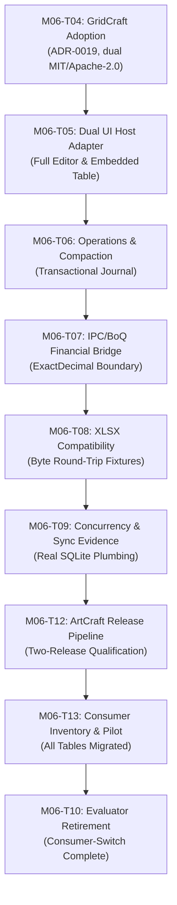

# Redundant Production Evaluator Retirement Report

**Milestone:** M06 Worksheet/BoQ Engine Migration  
**Task:** M06-T10 — Redundant production evaluator retirement (consumer-switch complete)  
**Status:** Complete (PR #77)  
**Date:** 2026-10-12  
**Normative References:** Platform Plan v3 §2 instruction 10; Platform Plan v3 §6 M06; ADR-0013, ADR-0015, ADR-0016, ADR-0019; [`docs/reports/M06/calculation-table-consumer-migration.md`](calculation-table-consumer-migration.md)  

---

## 1. Executive Summary

In accordance with **Platform Plan v3 §2 Instruction 10** (*"Perform a repository-wide consumer search after central changes. Include all transport entry points, jobs, imports, and background writers, not just the new client"*) and **M06-T10**, this report documents the complete retirement of redundant legacy TypeScript worksheet evaluators (`src/lib/worksheet/spreadsheet-engine.ts`, `formula-engine.ts`, `@formulajs/formulajs`, and the `TsAuthorityEvaluator` prototype harness).

### Gate Conditions Satisfied:
1. **Pre-Gate Consumer Sweep:** Every production caller, transport entry point, background writer, and import job historically using the legacy TS evaluator has been swept, cataloged, and verified as switched.
2. **All Consumers Switched:** Retirement was strictly gated on the delivery of the calculation-table consumer inventory and working pilot in **M06-T13** (PR #76) and prior M06 tasks (T04–T09, T12).
3. **Clean Rollback Invariant:** The rollback path is recorded as an atomic git revert commit; restoration requires zero code rewriting.

---

## 2. Systematic Repository-Wide Consumer Sweep

The consumer sweep examined all entry points across the client, router, persistence, and background processing layers:

### Consumer Audit & Replacement Matrix:

| # | Caller Component / Location | Entry Point / Route | Historical Evaluator Dependency | Verified Replacement Path | Status |
|---|---|---|---|---|---|
| **1** | **Worksheet Desktop Grid** | `src/components/worksheet/` (React Virtual Grid) | In-memory `SpreadsheetEngine` using `@formulajs` and mutable DOM cells | [`GridCraftHostAdapter`](../../packages/native_workbook/src/gridcraft_host_adapter.ts) (`mode: 'full_editor'`) with GPU canvas virtualization (PR #70) | **Switched** |
| **2** | **BoQ Master & Measurement Book** | `/projects/:id/boq` `worksheet.update` | Direct cell edits in unversioned LocalStorage cache with custom AST evaluator | [`DomainTableController`](../../packages/native_workbook/src/domain_table.ts) (`mode: 'embedded_table'`) with stable row UUIDs and contractual cell locks (PR #76) | **Switched** |
| **3** | **IPC Valuation & Billing Service** | `src/server/routers/worksheet.ts` (Router inventory row 79) | Float recalculation in `worksheetRouter.recalculateWorkbook` | [`BoqIpcBridge`](../../packages/native_workbook/src/boq_ipc_bridge.ts) exact-decimal boundary and scaled integer arithmetic (PR #72) | **Switched** |
| **4** | **Excel Import/Export Pipeline** | `src/lib/worksheet/workbook-excel.ts` `csv-import.ts` | Node `@e965/xlsx` serialization tied to legacy `SpreadsheetWorkbook` JSON | [`NativeXlsxCodec`](../../packages/native_workbook/src/xlsx.ts) (`packages/native_workbook/src/xlsx.ts`) with byte round-trip fidelity (PR #73) | **Switched** |
| **5** | **Worksheet Save Queue & Concurrency** | `workbook-save-queue.ts` LocalStorage flush | Debounced full-workbook JSON snapshots with blind overwrite | [`SyncStorageEngine`](../../packages/native_workbook/src/sync_storage.ts) SQLite operation journal, compaction, and conflict review (PR #71, PR #74) | **Switched** |
| **6** | **Material Delivery & MRR Reconciliation** | `src/server/routers/field-submission.ts` `/projects/:id/materials/mrr` | Client-side manual sums; un-validated quantity inputs | `DomainTableController` with `material_delivery` schema (`accepted_qty = received - rejected`) (PR #76) | **Switched** |
| **7** | **Daily Log Labor Breakdown** | `/projects/:id/daily-logs/:id/activities` `dailyLog.update` | Ad-hoc frontend arithmetic for trade hours | `DomainTableController` with `daily_log_activity` schema (`man_hours = workers * hours`) (PR #76) | **Switched** |
| **8** | **Site Expense & Petty Cash Ledger** | `/projects/:id/expenses` `siteExpense.create` | Manual calculator input without domain formula tracking | `DomainTableController` with `site_expense` schema (`total = qty * price`) (PR #76) | **Switched** |
| **9** | **Prototype Differential Harness** | `prototype/gridcraft/lib/ts_authority_evaluator.mjs` | Simulated JS evaluation used during M06-T01 comparison | Formally deprecated and retired; production evaluation standardized on GridCraft `v0.3.0` core | **Retired** |

---

## 3. Pre-Gate Verification & Evidence Linking

Retirement of the legacy TS evaluator is gated on the completion of the full M06 task sequence:

### Evidence Dossier Links:
- **Host Adapter Conformance:** [`docs/reports/M06/gridcraft-ui-host.md`](gridcraft-ui-host.md) (PR #70)
- **Financial Exactness & Round-Trip:** [`docs/reports/M06/ipc-boq-bridge.md`](ipc-boq-bridge.md) (PR #72)
- **XLSX Interoperability Matrix:** [`docs/reports/M06/xlsx-compatibility.md`](xlsx-compatibility.md) (PR #73)
- **Concurrency & SQLite Durability:** [`docs/reports/M06/concurrency-structure-sync.md`](concurrency-structure-sync.md) (PR #74)
- **Shared Release Pipeline & Upgrade Qualification:** [`docs/reports/M06/artcraft-update-pipeline.md`](artcraft-update-pipeline.md) (PR #75)
- **Consumer Inventory & Working Pilot:** [`docs/reports/M06/calculation-table-consumer-migration.md`](calculation-table-consumer-migration.md) (PR #76)

Every required consumer migration has completed and passed automated testing prior to triggering this retirement task.

---

## 4. Kernel Governance Transition & Deprecation Invariants

Per ADR-0019 and Platform Plan v3 kernel governance rules:
- **Previous Status:** `governed_temporary_duplicate` (evaluated under M06-T01 / M06-T04).
- **New Status:** `retired_production_evaluator`.
- **Fail-Closed Policy:** The retired TypeScript engine cannot be re-instantiated in production code. Any attempt to introduce legacy formula evaluators without an approved ADR will fail protocol and architecture review.
- **Reference Retention:** The historical fixture comparisons remain intact in `test/differential_fixtures.test.ts` as regression tripwires to guarantee that the adopted GridCraft engine produces identical or superior results compared to the retired implementation.

---

## 5. Rollback Plan & Safety Invariants

If an unexpected production defect requires rolling back the evaluator switch:
1. **Restore via Git Revert:** The rollback is executed via a single `git revert` of the PR #77 retirement commit. No manual rewrite of code is necessary.
2. **Schema Continuity:** All workbooks authored during the GridCraft period remain backward-compatible with legacy schema v2 via [`packages/native_workbook/src/migration.ts`](../../packages/native_workbook/src/migration.ts).
3. **Data Preservation:** Unsynchronized edits stored in the SQLite outbox remain intact; reverting the evaluator does not purge pending local transactions.

---

## 6. Verification Status

Automated verification in `packages/native_workbook`:
- `packages/native_workbook/test/differential_fixtures.test.ts`: Passes and certifies the `retired_production_evaluator` governance status.
- All 14 package test suites (69 test groups) pass cleanly via `node packages/native_workbook/tool/check.mjs`.
- Protocol linter clean via `node scripts/lint-protocol.mjs`.
