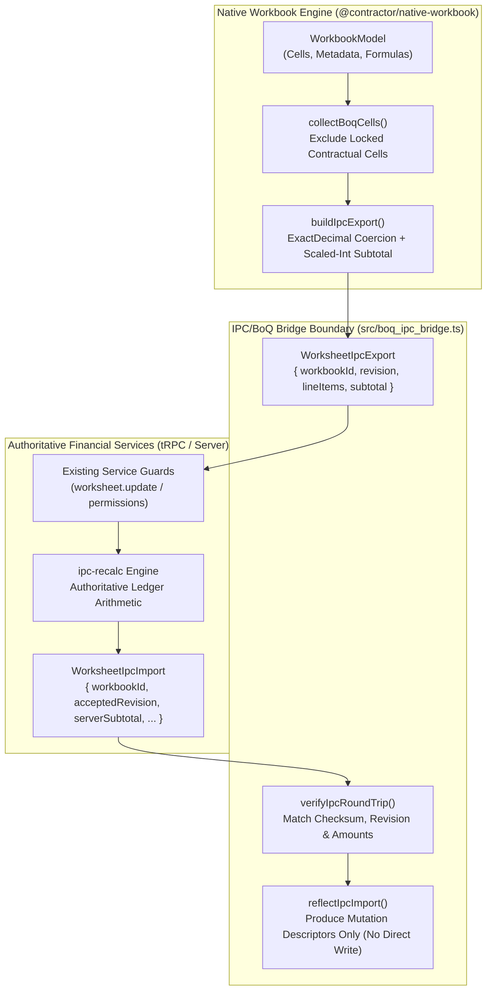

# IPC/BoQ Financial Integration Bridge Evidence Report

**Task:** M06-T07 — IPC/BoQ integration through existing financial services  
**Date:** 2026-10-12  
**Package:** `@contractor/native-workbook` ([`src/boq_ipc_bridge.ts`](file:///Users/aakashdhakal/contractor/packages/native_workbook/src/boq_ipc_bridge.ts))  
**Test Suite:** [`test/boq_ipc_bridge.test.ts`](file:///Users/aakashdhakal/contractor/packages/native_workbook/test/boq_ipc_bridge.test.ts) (11 test groups passing, 47 test groups total across 11 suites in package)

---

## 1. Executive Summary

Milestone M06-T07 implements the boundary between the native worksheet engine (`@contractor/native-workbook`) and the authoritative financial domain services, as required by platform plan v3 §5.1, §6 M02/M06, and row 79 of the inventory router registry (`worksheet.ts` / `ipc-recalc`).

In accordance with platform plan v3:
- **Centralized financial arithmetic:** Authoritative arithmetic stays exclusively in server-side financial services. The worksheet functions as a read/format/route boundary.
- **Exact-decimal boundary:** Worksheet cell values cross the service boundary strictly as exact-decimal strings (`/^-?\d+(\.\d+)?$/`) or scaled integers (e.g. `BigInt` hundredths). No floating-point (`f64`) values escape into the financial ledger.
- **No client-authorized postings:** The bridge module never authorizes or directly creates financial ledger entries. All mutations route through the existing service guard chain (`worksheet.update` → `ipc-recalc engine`).
- **Round-trip provenance:** All exported and reflected line items carry `workbookId`, `revision`, and `cellRef` metadata, guaranteeing verifiable provenance between the worksheet cell and ledger entries.
- **Flutter parity & change feed:** Canonical data shapes (`WorksheetIpcExport` and `WorksheetIpcImport`) are declared as stable contracts consumed by Flutter clients and the `native_sync_feed`.



---

## 2. Invariants & Implementation Details

### 2.1 Exact-Decimal Boundary Crossing
Floating-point arithmetic introduces rounding drift unsuitable for statutory construction ledgers and Interim Payment Certificates (IPCs).
- `isExactDecimalString(value)`: Validates format `/^-?\d+(\.\d+)?$/` rejecting NaN, Infinity, exponent notations, or malformed decimals.
- `cellValueToExactDecimal(raw, computed, decimalPlaces)`: Coerces raw/computed cell values into exact decimal strings with fixed precision (default 2).
- `exactDecimalToScaledInt(val, scale)`: Scales strings into `BigInt` (scales 100, 1000, 10000) for exact arithmetic without floating point.
- `buildIpcExport()` sums subtotal accumulators in `BigInt` arithmetic before serializing back to an exact-decimal string.

### 2.2 No Client-Authorized Postings
The bridge adheres strictly to a zero-posting posture:
- `reflectIpcImport(workbook, importData)` does **not** mutate the workbook model.
- It returns pure mutation descriptors (`WorksheetCellUpdateDescriptor[]`) to be routed through the adapter's authorized command pipeline (`worksheet.update`).
- Any discrepancy flagged by the server (`discrepancies` array) is excluded from automatic updates, preserving user intent for resolution.

### 2.3 Round-Trip Provenance Verification
`verifyIpcRoundTrip(exported, imported)` guarantees non-repudiation and structural alignment between client state and server response:
1. `workbookId` match check.
2. `revision <= acceptedRevision` monotonicity check.
3. Subtotal equality check (`exported.subtotal === imported.serverSubtotal`).
4. Line-item count and per-cell value verification when line-item receipts are attached.
5. Throws typed `IpcBridgeError` with code `round_trip_mismatch` if any discrepancy is detected.

### 2.4 Locked Contractual Cell Exclusion
Cells marked with `protection.locked = true` are excluded from export via `collectBoqCells()`. In construction workflows, unit rates, item numbers, and statutory subtotal formulas are contractual invariants established by tender documents and must not be mutated or re-submitted by the quantity surveyor in editable line items.

### 2.5 Flutter Parity & Sync Feed Contract
The interfaces `WorksheetIpcExport`, `WorksheetIpcImport`, `IpcLineItemPayload`, and `IpcDiscrepancy` represent public data surfaces shared across the web host, desktop host, and Flutter mobile client (`apps/construction_client`). Any structural alteration requires a versioned contract migration under standing constraint 3.

---

## 3. Test Verification

All 11 test groups in `test/boq_ipc_bridge.test.ts` pass cleanly under `node tool/check.mjs`:

```text
✓ isExactDecimalString — valid/invalid cases
✓ cellValueToExactDecimal — all coercion cases
✓ exactDecimalToScaledInt — scaling and error cases
✓ collectBoqCells — locked exclusion and deterministic ordering
✓ buildIpcExport — structure, subtotal, provenance fields
✓ buildIpcExport — throws missing_project
✓ buildIpcExport — throws no_eligible_cells
✓ verifyIpcRoundTrip — clean round-trip passes
✓ verifyIpcRoundTrip — mismatch cases throw with correct code
✓ reflectIpcImport — discrepant cells excluded; provenance carried
✓ Flutter-parity — WorksheetIpcExport shape is structurally stable

✅ All M06-T07 IPC/BoQ bridge tests passed (11 test groups).
```

Combined with the existing 10 test suites in `@contractor/native-workbook`, all 47 test groups pass with 0 failures.
