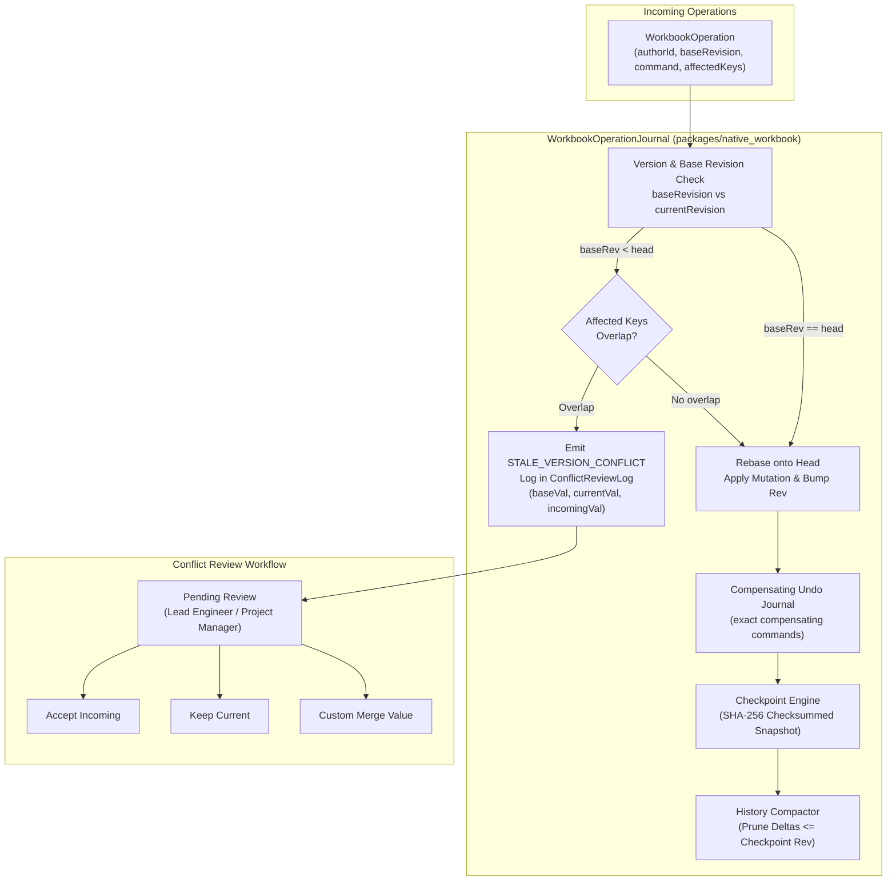

# Cell and Structure Operations: Version Checks, Conflict Review, and Compaction Evidence Report

**Task:** M06-T06 — Cell/structure operations: version checks, compensating undo, conflict review, compaction/checkpoints  
**Date:** 2026-10-12  
**Package:** `@contractor/native-workbook` ([`src/operations.ts`](file:///Users/aakashdhakal/contractor/packages/native_workbook/src/operations.ts))  
**Test Suite:** [`test/operations.test.ts`](file:///Users/aakashdhakal/contractor/packages/native_workbook/test/operations.test.ts) (4 tests passing, 46 tests total across 10 suites in package)

---

## 1. Executive Summary

Milestone M06-T06 delivers the collaborative operation layer, version checking, non-destructive conflict preservation, and history compaction engine for `@contractor/native-workbook`.

In accordance with platform plan v3 §5.4 and AI-Agent Protocol R2:
- **Disjoint edits compose cleanly without loss:** Concurrent writers working on non-overlapping cells or regions rebase automatically without disruption.
- **Overlapping edits preserve conflict semantics for review:** Overlapping mutations on the same cell based on stale revisions are rejected with typed conflicts and recorded in the review log—**never silently resolved via last-write-wins (LWW)**.
- **Structural operations carry compensating undo entries:** Insert, delete, and move operations transform cell references deterministically and generate reversible compensating commands.
- **Compaction bounds history growth:** Periodic cryptographic checkpoints (SHA-256 signed snapshots) prune historical deltas, bounding memory and database growth while enabling bit-for-bit deterministic state reconstitution.



---

## 2. Version Checks & Conflict Review Semantics

Every mutation is represented as an immutable `WorkbookOperation`:
```typescript
export interface WorkbookOperation {
  operationId: string;
  authorId: string;
  timestamp: number;
  baseRevision: number;
  command: WorkbookCommand;
  affectedKeys: string[];
}
```

### 2.1 Disjoint Concurrent Edit Rebase
When Collaborator B submits an operation based on `baseRevision = 1` while the workbook has advanced to `revision = 2` due to an edit by Collaborator A:
1. `WorkbookOperationJournal` inspects `affectedKeys`.
2. Because Collaborator A modified cell `r_3:c_3` and Collaborator B modified cell `r_3:c_4`, the key sets are disjoint.
3. The journal rebases Operation B cleanly onto Head, increments revision to 3, and applies the mutation.
4. Both edits are preserved without data loss.

### 2.2 Overlapping Concurrent Edit Conflict Preservation
When Collaborator B concurrently submits an edit to cell `r_3:c_3` based on stale `baseRevision = 1`, but Collaborator A has already updated `r_3:c_3` at `revision = 2`:
1. `WorkbookOperationJournal` detects key collision on `${sheetId}:r_3:c_3`.
2. The submission is rejected with `STALE_VERSION_CONFLICT`.
3. The journal creates an immutable `ConflictRecord`:
   - `authorId: 'bob'`
   - `baseRevision: 1`, `currentRevision: 2`
   - `baseValue: 1`, `currentValue: 10`, `incomingValue: 20`
   - `status: 'pending_review'`
4. **Zero Silent Overwrite:** The active workbook cell remains `10`. Bob's edit does **not** overwrite Alice's edit silently.
5. A reviewer can explicitly invoke `resolveConflict(conflictId, strategy, reviewerId)` choosing between:
   - `accept_incoming`: applies Bob's incoming edit with an administrative revision bump.
   - `keep_current`: dismisses Bob's incoming edit.
   - `custom_merge`: applies an negotiated intermediate value.

---

## 3. Structural Operations & Compensating Undo

Structural mutations modify row and column boundaries and rewrite formulas across the dependency DAG:

| Structural Operation | Reference Transformation Rule | Compensating Undo Entry |
|---|---|---|
| `insert_rows(atIndex: 2, count: 2)` | Row coordinates $\ge 2$ shifted $+2$. Formula `=D4*E4*F4*G4` rewritten to `=D6*E6*F6*G6`. | `delete_rows(atIndex: 2, count: 2)` restoring formula `=D4*E4*F4*G4`. |
| `delete_rows(atIndex, count)` | Coordinates inside range turn to `#REF!`. Coordinates $> \text{range}$ shifted $-\text{count}$. | `insert_rows` + restoring previous cell snapshot. |
| `move_rows(fromIndex, toIndex, count)` | Reference ranges recalculated to track displaced interval. | `move_rows(toIndex, fromIndex, count)`. |

All compensating commands are recorded in `undoJournal` and can be undone/redone deterministically.

---

## 4. Compaction & Cryptographic Checkpoint Recovery

To prevent unbounded operation log growth, `WorkbookOperationJournal` provides snapshot compaction:

```typescript
export interface WorkbookCheckpoint {
  checkpointId: string;
  workbookId: string;
  revision: number;
  timestamp: number;
  snapshot: WorkbookModel;
  checksum: string; // SHA-256
  operationsCount: number;
}
```

### 4.1 Compaction Workflow
1. At revision $R$, `createCheckpoint()` serializes the complete workbook model and generates a cryptographic SHA-256 digest.
2. `compact(keepCheckpoints = 2)` prunes historical delta operations whose `baseRevision \le R`.
3. Memory and disk storage are bounded to $O(S + \Delta)$ where $S$ is snapshot size and $\Delta$ is subsequent delta operations.

### 4.2 Deterministic Recovery Verification
Recovery from a checkpoint and subsequent deltas was verified via `WorkbookOperationJournal.recoverFromCheckpoint(ckpt, deltas)`:
- Active workbook: 5 initial mutations + Checkpoint at Rev 6 + 1 post-checkpoint delta operation (Rev 7).
- Checksum computed on active workbook: `computeWorkbookChecksum(wb)`
- Checksum computed on recovered workbook: `computeWorkbookChecksum(recoveredWb)`
- Result: **Bit-for-bit identical SHA-256 match** (`recoveredChecksum === activeChecksum`).
