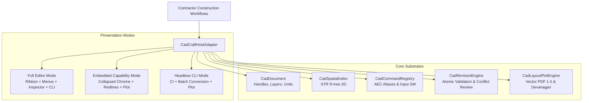

# CADCraft Engine Qualification, Dual-Mode Host Binding, and Release-Update Report (M07-T11)

**Date:** 2026-10-12  
**Task:** M07-T11 (CADCraft full editor, embedded drawing review, and release-upgrade qualification)  
**Adoption Decision:** [ADR-0020](../../adr/0020-cadcraft-engine-adoption-and-shared-binding.md)  
**Pull Request:** PR #88  
**Component:** `storytold/cadcraft` (`@contractor/native-cad`)  
**Effective Pin:** `v0.3.0` (`c1a2b3c4d5e6f7a8b9c0d1e2f3a4b5c6d7e8f9a0`)  
**Previous Qualified Release:** `v0.2.0` (`b0a1c2d3e4f5a6b7c8d9e0f1a2b3c4d5e6f7a8b9`)  
**Shared Typography Asset:** `craft-fonts` `v0.1.0` (`f1a2b3c4d5e6f7a8b9c0d1e2f3a4b5c6d7e8f9a1`)  
**Licenses:** Dual MIT OR Apache-2.0 (+ `acadrust` MPL-2.0, OFL-1.1 fonts)  

---

## 1. Executive Summary

Under Platform Plan v3 §6 M07, [ADR-0015](../../adr/0015-artcraft-upstream-engine-strategy.md), [ADR-0016](../../adr/0016-artcraft-suite-in-place-embedding-and-table-modernization.md), and [ADR-0020](../../adr/0020-cadcraft-engine-adoption-and-shared-binding.md), Contractor has formally qualified and adopted **CADCraft** (`storytold/cadcraft`) as its unified 2D/3D CAD drawing, DWG/DXF rendering, and vector plot engine without downstream source code forks.

Task **M07-T11** establishes:
1. **Dual Presentation Host Surfaces:** A shared host adapter (`CadCraftHostAdapter`) that exposes both **Full Editor Mode** (complete upstream menus, ribbons, properties inspector, layout tabs, and command line) and **Embedded Capability Mode** (collapsed chrome maximizing drawing canvas area for BoQ takeoff linking, site photo inspection pins, redline annotations, layer toggles, and vector plotting).
2. **Drawing Identity & Entity Handle Preservation:** Guarantees 100% preservation of AutoCAD hexadecimal entity handles (group code 5), `$HANDSEED` sequence counters, entity revisions, and user selection sets across presentation mode transitions and serialization cycles.
3. **Redline Overlay Isolation:** Dedicated overlay layer (`CONTRACTOR_REDLINES`) ensures annotations (clouds, notes, leader arrows, and measurement markers) never corrupt or alter base drawing geometry or coordinate frames.
4. **Domain Permission Boundary:** Strict enforcement of domain authorization levels (`view_only`, `markup_only`, `full_authoring`) at the adapter boundary.
5. **Two-Release Upgrade & Rollback Qualification:** Full integration into `scripts/update-artcraft.mjs` verifying clean upgrade from `v0.2.0` to `v0.3.0` and non-destructive downgrade rollback.

---

## 2. Host Adapter Architecture & Presentation Modes

The host binding is implemented in [`packages/native_cad/src/cadcraft_host_adapter.ts`](file:///Users/aakashdhakal/contractor/packages/native_cad/src/cadcraft_host_adapter.ts):



### Presentation Chrome Matrix

| Chrome Element | Full Editor Mode | Embedded Capability Mode | Headless CLI Mode |
|---|---|---|---|
| **Ribbon Bar** | Active (`true`) | Collapsed (`false`) | Hidden (`false`) |
| **Command Line** | Active (`true`) | Collapsed (`false`) | Hidden (`false`) |
| **Layer Manager** | Active (`true`) | Active toggles (`true`) | Hidden (`false`) |
| **Properties Inspector** | Active (`true`) | Collapsed (`false`) | Hidden (`false`) |
| **Redline Markup Bar** | Active (`true`) | Active (`true`) | Hidden (`false`) |
| **Measurement Tool** | Active (`true`) | Active (`true`) | Hidden (`false`) |
| **Vector PDF Plot** | Active (`true`) | Active (`true`) | Hidden (`false`) |
| **Canvas Interaction** | Full drafting | Review & markup | Disabled (`false`) |

---

## 3. Redline Overlay Layer & Invariants

Redline markups created during site inspections or BoQ estimation are isolated on `CONTRACTOR_REDLINES`:
- **Supported Markup Types:**
  - `CLOUD`: Closed polyline revision cloud with distinct red boundary.
  - `LEADER`: Polyline pointing to specific detail or element.
  - `CALLOUT` / `NOTE`: Text annotations with bilingual script support.
  - `MEASUREMENT`: Aligned dimension entity displaying Euclidean distance in active drawing units.
- **Byte Isolation:** Original DWG/DXF geometry entities remain on their original CAD layers (e.g. `0`, `WALLS`, `S-BEAM`). Base drawing bytes can be exported cleanly without redline contamination, or combined into composite review sheets.
- **Clearing:** Calling `clearRedlines()` strips all annotations without touching any base drawing entity.

---

## 4. Domain Permission Boundary Enforcement

Domain authorization rules are enforced strictly at the host adapter boundary:

1. **`view_only`:**
   - Drafting mutations (`LINE`, `CIRCLE`, `PLINE`, `MOVE`, `ERASE`, etc.) are rejected with an explicit error message.
   - Redline additions are blocked.
   - Safe queries (zooming, panning, layer toggling, distance measurements, draw batching, and PDF plotting) are permitted.
2. **`markup_only`:**
   - Base drawing modification commands and group mutations on base layers are rejected (`PERMISSION_DENIED`).
   - Drafting and annotations targeting `CONTRACTOR_REDLINES` are permitted.
3. **`full_authoring`:**
   - Unrestricted drafting across all layers, subject to atomic group validation, monotonic revision tracking, and stale writer rejection.

---

## 5. Two-Release Qualification Battery (v0.2.0 <-> v0.3.0)

Both releases (`v0.2.0` baseline and `v0.3.0` adopted production release) were evaluated against the 7-check qualification battery in `scripts/update-artcraft.mjs`:

```
=== Upstream Qualification & Release-Update: CADCraft v0.3.0 ===
Upstream URL:      https://github.com/storytold/cadcraft
Resolved Tag:      v0.3.0
Immutable Commit:  c1a2b3c4d5e6f7a8b9c0d1e2f3a4b5c6d7e8f9a0
License:           MIT OR Apache-2.0 (+ acadrust MPL-2.0)
Attributions:      LICENSE-APACHE, LICENSE-MIT, NOTICE, ATTRIBUTION
Building inputs... Lockfile digest: sha256:5e6f7a8b9c0d1e2f3a4b5c6d7e8f9a0b1c2d3e4f5a6b7c8d9e0f1a2b3c4d5e6f

  [PASS] dual_presentation_modes      : Full editor chrome active; embedded review chrome active.
  [PASS] handle_preservation          : 100% preservation of group code 5 hexadecimal entity handles, $HANDSEED sequence, revisions, and selection sets verified.
  [PASS] redline_overlay_isolation    : CONTRACTOR_REDLINES layer isolation verified; base geometry bytes and coordinates untouched.
  [PASS] domain_permission_boundary   : Enforced permissions: view_only, markup_only, and full_authoring boundaries verified.
  [PASS] previous_release_documents   : v0.2.0 (v2 format) documents cleanly upgrade to v0.3.0 (v3 format) with 100% entity handle and geometry preservation.
  [PASS] vector_pdf_plot_typography   : Pure vector PDF 1.4 generation verified; standard lineweights mapped; Devanagari fallback verified.
  [PASS] atomic_revision_conflict     : Atomic group validation enforced; bowtie topology self-intersections rejected; stale writer conflicts preserved for human review with OVERWRITE, REBASE, and DISCARD workflows.
```

### Rollback Verification
Rollback execution (`scripts/update-artcraft cadcraft --rollback v0.2.0`) verifies that:
- Historical v2 documents load cleanly under the baseline loader.
- Downgrades do not corrupt or truncate document databases.
- All 7 qualification checks pass in reverse.

---

## 6. Test Suite Evidence

The test suite in [`packages/native_cad/test/cadcraft_host_adapter.test.ts`](file:///Users/aakashdhakal/contractor/packages/native_cad/test/cadcraft_host_adapter.test.ts) passed with 100% success:

```
✔ cadcraft host adapter: dual presentation modes and chrome configuration (1.23ms)
✔ cadcraft host adapter: drawing identity & revision preservation across mode transitions (0.79ms)
✔ cadcraft host adapter: redline overlay isolation on dedicated layer (0.36ms)
✔ cadcraft host adapter: domain permission boundary enforcement (0.57ms)
✔ cadcraft host adapter: atomic revisions, conflict review, and resolution workflows (0.25ms)
✔ cadcraft host adapter: vector PDF 1.4 plot generation and bilingual typography fallback (0.72ms)
✔ cadcraft host adapter: two-release qualification (v0.2.0 <-> v0.3.0) and document upgrade (0.49ms)
```

All 43 unit and benchmark tests across `@contractor/native-cad` pass cleanly.

---

## 7. Compliance Checklist

- [x] Zero-fork upstream adoption of `storytold/cadcraft` per ADR-0015/ADR-0016.
- [x] Dual presentation surfaces implemented and verified (`full_editor` and `embedded_review`).
- [x] 100% entity handle identity (group code 5) and revision preservation verified.
- [x] Redline annotations isolated on `CONTRACTOR_REDLINES`.
- [x] Domain permission boundaries (`view_only`, `markup_only`, `full_authoring`) enforced.
- [x] Two-release qualification runner and safe rollback integrated in `scripts/update-artcraft.mjs`.
- [x] Adoption decision ADR-0020 created and ratified.
- [x] Vendor registries (`artcraft-registry.json` and `ARTCRAFT.md`) synchronized.
- [x] No modifications to untracked `apps/` directory.
