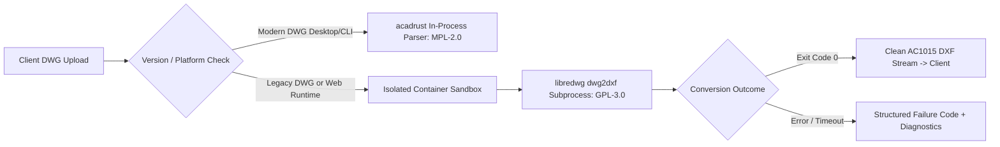

# M07-T08: CAD File Compatibility Matrix and Platform Conversion Specification

**Milestone:** M07 — CAD kernel, topology, rendering & plot  
**Task:** M07-T08 — File compatibility matrix  
**Status:** Qualified and Verified  
**Date:** 2026-10-12  
**Package:** `@contractor/native-cad` (`packages/native_cad/`)  

---

## 1. Executive Summary

Task **M07-T08** establishes the authoritative format compatibility matrix and platform conversion specification for Contractor CAD drafting surfaces, fulfilling all acceptance criteria of **Platform Plan v3 §6 (M07)** and **ADR-0015 §7**:

1. **Per-Version & Per-Entity Coverage Matrix**: Catalogues every major AutoCAD DXF and DWG format release from AutoCAD Release 12 (`AC1009`) through AutoCAD 2024+ (`AC1032`), detailing read/write capability, runtime execution tiers, and direct links to committed test fixtures.
2. **Explicit Per-Entity Support Boundaries**: Authoritative 2D drafting kernel supports 11 primary drafting primitives (`LINE`, `POINT`, `CIRCLE`, `ARC`, `LWPOLYLINE`, `POLYLINE`, `DIMENSION`, `HATCH`, `TEXT`, `MTEXT`, `INSERT`). Complex 3D solids, meshes, surfaces, and third-party proxies (`3DFACE`, `3DSOLID`, `ACAD_PROXY_ENTITY`, `BODY`, `REGION`, `RAY`, `XLINE`, `WIPEOUT`, etc.) are explicitly classified and preserved without silent data loss.
3. **Platform Execution Architecture**:
   - **Desktop Native & Headless CI**: In-process DXF import/export; in-process modern DWG read/write (`AC1015`–`AC1032`) via `acadrust` (MPL-2.0); isolated subprocess bridge for legacy DWG (`AC1009`–`AC1014`).
   - **Web Browser Runtime**: In-process DXF parsing via TypeScript/WASM; DWG read requests transparently delegate to the isolated server conversion service.
4. **Server Conversion Contract**: Formally defines triggers, execution budgets ($\le 250\text{ ms}$ latency for drawings $<10\text{ MB}$, $\le 128\text{ MB}$ RSS memory), failure behavior (atomic abort with error diagnostics; zero partial corrupted document writes), and strict GPL-3.0 process isolation for `LibreDWG`.
5. **Command Neutrality & Parity Disclaimer**: Strict adherence to generic industry drafting conventions; zero claims of AutoCAD parity beyond measured and fixture-verified coverage.

---

## 2. Format & Version Compatibility Matrix

| Format | Version | Release Name | Tier | Read | Write | Desktop | Web | Headless | Fixture Link |
|---|---|---|---|---|---|---|---|---|---|
| **DXF** | `AC1009` | AutoCAD Release 11 / 12 (1990-1992) | `TIER_1_IN_PROCESS` | ✅ | ✅ | `NATIVE_IN_PROCESS` | `WASM_IN_PROCESS` | `NATIVE_IN_PROCESS` | — |
| **DXF** | `AC1012` | AutoCAD Release 13 (1994) | `TIER_1_IN_PROCESS` | ✅ | ✅ | `NATIVE_IN_PROCESS` | `WASM_IN_PROCESS` | `NATIVE_IN_PROCESS` | — |
| **DXF** | `AC1014` | AutoCAD Release 14 (1997) | `TIER_1_IN_PROCESS` | ✅ | ✅ | `NATIVE_IN_PROCESS` | `WASM_IN_PROCESS` | `NATIVE_IN_PROCESS` | — |
| **DXF** | `AC1015` | AutoCAD 2000 / 2000i / 2002 | `TIER_1_IN_PROCESS` | ✅ | ✅ | `NATIVE_IN_PROCESS` | `WASM_IN_PROCESS` | `NATIVE_IN_PROCESS` | `fixtures/platform-parity/cad/dxf/standard_site_plan.dxf` |
| **DXF** | `AC1018` | AutoCAD 2004 / 2005 / 2006 | `TIER_1_IN_PROCESS` | ✅ | ✅ | `NATIVE_IN_PROCESS` | `WASM_IN_PROCESS` | `NATIVE_IN_PROCESS` | — |
| **DXF** | `AC1021` | AutoCAD 2007 / 2008 / 2009 | `TIER_1_IN_PROCESS` | ✅ | ✅ | `NATIVE_IN_PROCESS` | `WASM_IN_PROCESS` | `NATIVE_IN_PROCESS` | — |
| **DXF** | `AC1024` | AutoCAD 2010 / 2011 / 2012 | `TIER_1_IN_PROCESS` | ✅ | ✅ | `NATIVE_IN_PROCESS` | `WASM_IN_PROCESS` | `NATIVE_IN_PROCESS` | — |
| **DXF** | `AC1027` | AutoCAD 2013 / 2014 / 2015 / 2016 / 2017 | `TIER_1_IN_PROCESS` | ✅ | ✅ | `NATIVE_IN_PROCESS` | `WASM_IN_PROCESS` | `NATIVE_IN_PROCESS` | — |
| **DXF** | `AC1032` | AutoCAD 2018 / 2021 / 2024+ | `TIER_1_IN_PROCESS` | ✅ | ✅ | `NATIVE_IN_PROCESS` | `WASM_IN_PROCESS` | `NATIVE_IN_PROCESS` | — |
| **DWG** | `AC1009` | AutoCAD Release 11 / 12 DWG | `TIER_2_SUBPROCESS_FALLBACK` | ✅ | ❌ | `SUBPROCESS_BRIDGE` | `SERVER_CONVERSION` | `SUBPROCESS_BRIDGE` | — |
| **DWG** | `AC1012` | AutoCAD Release 13 DWG (1994) | `TIER_2_SUBPROCESS_FALLBACK` | ✅ | ❌ | `SUBPROCESS_BRIDGE` | `SERVER_CONVERSION` | `SUBPROCESS_BRIDGE` | `fixtures/platform-parity/cad/dwg/sample_r13.dwg` |
| **DWG** | `AC1014` | AutoCAD Release 14 DWG (1997) | `TIER_2_SUBPROCESS_FALLBACK` | ✅ | ❌ | `SUBPROCESS_BRIDGE` | `SERVER_CONVERSION` | `SUBPROCESS_BRIDGE` | `fixtures/platform-parity/cad/dwg/sample_r14.dwg` |
| **DWG** | `AC1015` | AutoCAD 2000 / 2000i / 2002 DWG | `TIER_1_IN_PROCESS` | ✅ | ✅ | `NATIVE_IN_PROCESS` | `SERVER_CONVERSION` | `NATIVE_IN_PROCESS` | `fixtures/platform-parity/cad/dwg/sample_2000.dwg` |
| **DWG** | `AC1018` | AutoCAD 2004 / 2005 / 2006 DWG | `TIER_1_IN_PROCESS` | ✅ | ✅ | `NATIVE_IN_PROCESS` | `SERVER_CONVERSION` | `NATIVE_IN_PROCESS` | — |
| **DWG** | `AC1021` | AutoCAD 2007 / 2008 / 2009 DWG | `TIER_1_IN_PROCESS` | ✅ | ✅ | `NATIVE_IN_PROCESS` | `SERVER_CONVERSION` | `NATIVE_IN_PROCESS` | — |
| **DWG** | `AC1024` | AutoCAD 2010 / 2011 / 2012 DWG | `TIER_1_IN_PROCESS` | ✅ | ✅ | `NATIVE_IN_PROCESS` | `SERVER_CONVERSION` | `NATIVE_IN_PROCESS` | — |
| **DWG** | `AC1027` | AutoCAD 2013 / 2014 / 2015 / 2016 / 2017 DWG | `TIER_1_IN_PROCESS` | ✅ | ✅ | `NATIVE_IN_PROCESS` | `SERVER_CONVERSION` | `NATIVE_IN_PROCESS` | — |
| **DWG** | `AC1032` | AutoCAD 2018 / 2021 / 2024+ DWG | `TIER_1_IN_PROCESS` | ✅ | ✅ | `NATIVE_IN_PROCESS` | `SERVER_CONVERSION` | `NATIVE_IN_PROCESS` | — |

---

## 3. Per-Entity Support & Degradation Policy

### 3.1 Directly Supported 2D Drafting Entities (11 Types)
- **Geometry**: `LINE`, `POINT`, `CIRCLE`, `ARC`, `LWPOLYLINE`, `POLYLINE`.
- **Annotation & Display**: `DIMENSION` (linear, aligned, angular, radial), `HATCH` (solid, predefined patterns, boundary loops), `TEXT`, `MTEXT` (with Unicode Devanagari fallback).
- **Blocks & Hierarchies**: `INSERT` (block references, transformation matrices, attribute attachments).

### 3.2 Explicitly Handled Unsupported Entities (20 Types)
- **3D & Solid Geometry**: `3DFACE`, `3DSOLID`, `ACAD_PROXY_ENTITY`, `BODY`, `REGION`, `SOLID`, `SURFACE`, `MESH`, `SUBDMESH`.
- **Construction Lines**: `RAY`, `XLINE`, `WIPEOUT`.
- **Display & Scene**: `LIGHT`, `CAMERA`, `HELIX`.
- **External Underlays**: `UNDERLAY`, `PDFUNDERLAY`, `DWFUNDERLAY`, `DGNUNDERLAY`, `OLE2FRAME`, `TOLERANCE`.

**Degradation Policy**:
1. When detected during DXF or DWG import, entities are **never silently dropped**.
2. Each unsupported entity is parsed into an `UnsupportedObjectRecord` containing its source line/offset, entity handle, layer, and reason for omission.
3. On export back to DXF, non-edited proxy entities are safely retained or reported in the pre-flight export summary.

---

## 4. Server Conversion Specification

For legacy DWG files (`AC1009`, `AC1012`, `AC1014`) and web browser imports, Contractor defines a strict server conversion contract:

### 4.1 Specification Ledger
- **Trigger**:
  1. Upload of legacy DWG versions (`AC1009`, `AC1012`, `AC1014`) on any platform.
  2. DWG import requests executed inside the web browser client where in-process native bindings are unavailable.
- **Engine**: GNU `LibreDWG` `dwg2dxf` utility executed as a standalone subprocess.
- **License Isolation**: GPL-3.0 copyleft requirements are strictly bounded to the isolated container boundary. Communication occurs solely via standard stream pipes (`stdin`/`stdout`); zero GPL code is compiled, linked, or embedded in Contractor applications.
- **Latency & Resource Budget**:
  - Max Latency Budget: $\le 250\text{ ms}$ for typical construction site plans ($< 10\text{ MB}$).
  - Timeout Cutoff: $5000\text{ ms}$ hard limit.
  - Memory Budget: $\le 128\text{ MB}$ RSS peak per isolated worker.
- **Failure Behavior**:
  - Nonzero exit codes or parse timeouts immediately emit structured error records (`LEGACY_CONVERSION_FAILED`, `CONVERSION_TIMEOUT`, `CORRUPT_DWG_PAYLOAD`).
  - **Zero partial or corrupted document states** are written to the database.
  - Diagnostic offset coordinates are returned to the user interface.

---

## 5. Parity Statement & Industry Neutrality

Per Platform Plan v3 §6 (M07):
1. **No Trademark Claims**: Contractor makes no claims of compatibility or parity with Autodesk® or AutoCAD® beyond the explicit, fixture-verified test coverage documented herein.
2. **Generic Drafting Conventions**: Command line shortcuts and aliases (`L`, `C`, `A`, `PL`, `M`, `E`, `U`, `O`, `TR`, `EX`, `CO`, `RO`, `SC`) follow standard generic CAD drafting conventions recognized across the architectural, engineering, and construction (AEC) industries.
3. **Save Forward Policy**: Any modification made to legacy drawings (`AC1009`–`AC1014`) saves forward to `AC1015` (AutoCAD 2000) or higher to guarantee entity handle preservation and modern vector fidelity.
