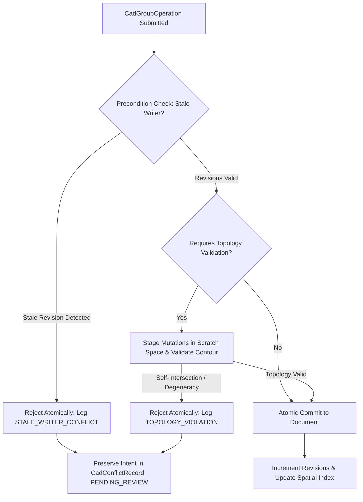

# M07-T07: CAD Revision Checks, Atomic Group Validation, and Conflict Resolution

**Milestone:** M07 — CAD kernel, topology, rendering & plot  
**Task:** M07-T07 — Entity/group operation revision checks and conflict resolution  
**Status:** Qualified and Verified  
**Date:** 2026-10-12  
**Package:** `@contractor/native-cad` (`packages/native_cad/`)  

---

## 1. Executive Summary

Task **M07-T07** delivers the entity-level revision tracking, atomic group operation validation, and collaborative conflict resolution engine for the Contractor native CAD substrate, strictly fulfilling the contract defined in **Platform Plan v3 §5.4 (CAD Row Contract)**:

> *"Entity revisions; independent edits compose; topology-changing/group operations validate their whole affected set atomically; conflicts preserve intent for review; never last-write-wins."*

Key architectural deliverables:
1. **Entity-Level Revisions & Audit Metadata**: Every CAD entity (`BaseCadEntity`) maintains a monotonically increasing `revision` number, alongside `updatedBy` and `updatedAt` audit tracking.
2. **Clean Composition of Independent Edits**: Disjoint concurrent mutations (e.g. an architect modifying wall lengths while a structural engineer updates column placements) compose without locking or spurious conflict rejections.
3. **Atomic Group Operation Execution**: Group operations (`CadGroupOperation`) execute with all-or-nothing semantics. If any precondition or validation fails, zero partial mutations are committed to the drawing database.
4. **Atomic Topology Boundary Validation**: When operations alter boundary contours or deduction sets, candidate geometry is evaluated in scratch memory. If boundary self-intersection (e.g. bowtie/hourglass distortion), open contours, or degeneracies occur, the entire operation is rejected atomically.
5. **No Silent Last-Write-Wins (LWW)**: Conflicting writes never silently overwrite peer edits. The rejected mutations and author intent are preserved in structured conflict records (`CadConflictRecord`) for review.
6. **Explicit Conflict Resolution Workflows**: Provides human review workflows (`OVERWRITE`, `REBASE`, `DISCARD`) with clear audit trails.

---

## 2. Architecture & Engine Design

Located at `packages/native_cad/src/revision_and_conflict.ts` and `packages/native_cad/src/types.ts`:

### 2.1 Entity Revision Metadata
```typescript
export interface BaseCadEntity {
  handle: string;
  type: CadEntityType;
  layer: string;
  color?: CadColor;
  lineweight?: number;
  linetype?: string;
  visible?: boolean;
  revision?: number;     // Monotonic version counter (starts at 1)
  updatedBy?: string;    // User or agent ID responsible for mutation
  updatedAt?: number;    // UTC timestamp of last update
}
```

### 2.2 Atomic Group Operation Execution Pipeline

When `CadRevisionEngine.applyGroupOperation(doc, op)` is called:



1. **Precondition Check (Stale Writer Detection)**:
   - For every `UPDATE` or `DELETE` mutation in the group, the engine compares `expectedRevision` against the entity's current revision in the active document.
   - If any handle has drifted (`expectedRevision !== currentRevision`), the operation is rejected.
   - A `CadConflictRecord` is created with reason `STALE_WRITER_CONFLICT`, capturing `conflictingHandles`, expected vs actual revisions, and the full `rejectedMutations` array.
2. **Atomic Topology Validation**:
   - If `requiresTopologyValidation: true`, the candidate mutations are staged into an isolated scratch map.
   - The boundary contour (e.g., room perimeter, slab boundary, lot boundary) is extracted and validated using `validatePolygon()` (from M07-T03 topology primitives).
   - If the polygon self-intersects (such as a bowtie / figure-eight configuration) or fails orientation/closure checks, the operation is rejected with `TOPOLOGY_VIOLATION`.
   - **Crucial Invariant**: Zero partial entities are updated. If 5 entities were part of the group, none are committed to the drawing database.
3. **Atomic Commit**:
   - Once all preconditions and topology checks pass, mutations are committed to the document:
     - `_insertEntity`, `_updateEntity`, or `_removeEntity` update the internal entity tables, advance entity revision numbers, refresh the R-tree spatial index (`CadSpatialIndex`), and register dirty envelopes in `CadInvalidationTracker`.
     - Document revision is incremented.

---

## 3. Conflict Resolution Workflows

Per Platform Plan v3 §5.4, conflicts preserve author intent rather than destroying data via Last-Write-Wins:

| Resolution Mode | Behavior | Use Case |
|---|---|---|
| **`DISCARD`** | Marks conflict status `RESOLVED_DISCARD`. No entities in the document are altered. | Conflicting edit was superseded or abandoned by author. |
| **`OVERWRITE`** | Forces application of the author's rejected mutations, updating revisions and author IDs. | Senior reviewer or author confirms their changes take precedence over concurrent edits. |
| **`REBASE`** | Updates mutation `expectedRevision` values to current document head revisions and re-executes atomic group validation. | Edits are non-conflicting in intent but were submitted against an older document version. |

---

## 4. Test Verification Matrix

All tests run via `packages/native_cad/tool/check.mjs` and execute under Node.js:

| Test Case | Verification Target | Status |
|---|---|---|
| **Independent Concurrent Edits** | Confirms disjoint mutations on separate entities compose cleanly without conflict and advance entity revisions. | **PASS** |
| **Stale Writer Conflict & Intent Preservation** | Confirms stale revision expectations halt execution, prevent document overwrite (no LWW), and store full intent in `CadConflictRecord`. | **PASS** |
| **Atomic Topology Rejection** | Distorts boundary contour into bowtie self-intersection alongside valid entity moves; verifies zero partial updates commit to document. | **PASS** |
| **Conflict Resolution Workflows** | Validates `DISCARD`, `OVERWRITE`, and `REBASE` lifecycle paths on pending conflicts. | **PASS** |

---

## 5. Summary & Platform Conformance

Task M07-T07 completes the CAD revision and collaborative editing contract. All mutations now execute under strict transactional integrity, preventing corrupt geometry and silent overwrites in multi-user takeoff and drafting environments.
