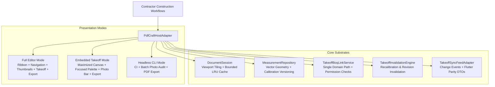

# PdfCraft Engine Qualification, Dual-Mode Host Binding, and Release-Update Report (M08-T09)

**Date:** 2026-10-12  
**Task:** M08-T09 (PdfCraft full editor, embedded takeoff/preview, and release-upgrade qualification)  
**Adoption Decision:** [ADR-0021](../../adr/0021-pdfcraft-engine-adoption-and-shared-binding.md)  
**Pull Request:** PR #97  
**Component:** `storytold/pdfcraft` (`@contractor/native-takeoff`)  
**Effective Pin:** `v0.4.0` (`e4f5a6b7c8d9e0f1a2b3c4d5e6f7a8b9c0d1e2f3`)  
**Previous Qualified Release:** `v0.3.0` (`d3c2b1a0f9e8d7c6b5a4f3e2d1c0b9a8f7e6d5c4`)  
**Licenses:** Dual MIT OR Apache-2.0  

---

## 1. Executive Summary

Under Platform Plan v3 §6 M08, [ADR-0015](../../adr/0015-artcraft-upstream-engine-strategy.md), [ADR-0016](../../adr/0016-artcraft-suite-in-place-embedding-and-table-modernization.md), and [ADR-0021](../../adr/0021-pdfcraft-engine-adoption-and-shared-binding.md), Contractor has formally qualified and adopted **PdfCraft** (`storytold/pdfcraft`) as its unified PDF rendering, annotation, and measurement takeoff engine without downstream source code forks.

Task **M08-T09** establishes:
1. **Dual Presentation Host Surfaces:** A shared host adapter ([`PdfCraftHostAdapter`](file:///Users/aakashdhakal/contractor/packages/native_takeoff/src/pdfcraft_host_adapter.ts)) exposing both **Full Editor Mode** (complete upstream ribbon, page thumbnails, annotation palette, and export actions) and **Embedded Takeoff Mode** (collapsed ribbon/sidebar maximizing the blueprint canvas for BoQ quantity takeoff, measurement drafting, site photo markup pins, and calibration).
2. **Headless CLI / MCP Host:** Zero-UI automation surface for headless CI testing, batch format migrations, and photo-to-PDF audit report generation.
3. **Document Identity & Revision Invariant Preservation:** Guarantees 100% preservation of document IDs, revision IDs, active page index, selection state, calibration records, and vector measurements across mode transitions and serialization cycles.
4. **Domain Permission Boundary:** Enforces strict domain authorization levels (`view_only`, `takeoff_markup_only`, `full_authoring`) at the adapter boundary.
5. **Single Domain Integration Path to BoQ:** Quantity postings flow exclusively through [`TakeoffBoqLinkService`](file:///Users/aakashdhakal/contractor/packages/native_takeoff/src/boq_link_service.ts) using the `"worksheet.update"` operation with permission checks intact; drawing widgets are architecturally prohibited from mutating BoQ cells directly.
6. **M04 Site Photo Markup Pipeline:** Site photo embedding with non-destructive vector callout overlays and audit export.
7. **Two-Release Upgrade & Rollback Qualification:** Full integration into `scripts/update-artcraft.mjs` verifying clean upgrade from `v0.3.0` (format version 3) to `v0.4.0` (format version 4) and non-destructive downgrade rollback.

---

## 2. Host Adapter Architecture & Presentation Modes

The host binding is implemented in [`packages/native_takeoff/src/pdfcraft_host_adapter.ts`](file:///Users/aakashdhakal/contractor/packages/native_takeoff/src/pdfcraft_host_adapter.ts):



### Presentation Chrome Matrix

| Chrome Element | Full Editor Mode | Embedded Takeoff Mode | Headless CLI Mode |
|---|---|---|---|
| **Ribbon Toolbar** | Active (`true`) | Collapsed (`false`) | Hidden (`false`) |
| **Sidebar Navigation** | Active (`true`) | Collapsed (`false`) | Hidden (`false`) |
| **Thumbnail View** | Active (`true`) | Collapsed (`false`) | Hidden (`false`) |
| **Takeoff Palette** | Active (`true`) | Active (`true`) | Hidden (`false`) |
| **Photo Markup Bar** | Active (`true`) | Active (`true`) | Hidden (`false`) |
| **Export Button** | Active (`true`) | Active (`true`) | Hidden (`false`) |
| **Canvas Interaction** | Full authoring | Takeoff & markup | Disabled (`false`) |

---

## 3. Domain Permission Boundary Enforcement

Domain authorization rules are enforced strictly at the host adapter boundary:

1. **`view_only`:**
   - Drafting mutations (`addMeasurement`) and photo attachments (`addPhotoMarkup`) are rejected with `PERMISSION_DENIED`.
   - Direct or indirect BoQ quantity postings (`postTakeoffQuantityToBoq`) are blocked.
   - Read-only queries (zooming, panning, page navigation, measurement queries, and package inspection) are permitted.
2. **`takeoff_markup_only`:**
   - Base PDF document structure modifications are restricted.
   - Vector takeoff measurements and photo callout markups are permitted.
   - Quantity postings via `TakeoffBoqLinkService` are permitted subject to user role and project permission checks (`worksheet.write` / `takeoff.post_quantity`).
3. **`full_authoring`:**
   - Unrestricted PDF page manipulation, annotation, and authoring.

---

## 4. Single Domain Integration Path to BoQ & Architectural Guards

Contractor Platform Plan v3 §6 M08 mandates that drawing widgets cannot mutate BoQ cells directly:

- **Architectural Guard:** `TakeoffDrawingWidget` throws `DirectMutationProhibitedError` on any attempt to mutate cells directly.
- **Service Mediation:** Quantity changes must flow through `postTakeoffQuantityToBoq`, which calls `TakeoffBoqLinkService.postQuantityUpdate`.
- **Exact Decimal Boundary:** Quantities cross service boundaries as exact decimal strings (e.g. `"40.00"`), preventing floating-point drift.
- **Idempotency & Double-Counting Prevention:** Replayed measurements (M03 sync feed replay) and repeated links are aggregated idempotently by link ID.

---

## 5. Two-Release Qualification Battery (v0.3.0 <-> v0.4.0)

Both releases (`v0.3.0` baseline and `v0.4.0` adopted production release) were evaluated against the 7-check qualification battery in `scripts/update-artcraft.mjs`:

```
=== Upstream Qualification & Release-Update: PdfCraft v0.4.0 ===
Upstream URL:      https://github.com/storytold/pdfcraft
Resolved Tag:      v0.4.0
Immutable Commit:  e4f5a6b7c8d9e0f1a2b3c4d5e6f7a8b9c0d1e2f3
License:           MIT OR Apache-2.0
Attributions:      LICENSE-APACHE, LICENSE-MIT, NOTICE, ATTRIBUTION
Building inputs... Lockfile digest: sha256:e4f5a6b7c8d9e0f1a2b3c4d5e6f7a8b9c0d1e2f3a4b5c6d7e8f9a0b1c2d3e4f5

  [PASS] dual_presentation_modes      : Full editor chrome active (ribbon, navigation, sidebar, annotation tools, export); embedded takeoff chrome active (collapsed ribbon/sidebar, maximized blueprint canvas, focused takeoff palette, photo markup bar, export).
  [PASS] measurement_provenance_preservation : 100% preservation of calibrated vector measurements, revision IDs, crop/rotation settings, and selection state across presentation mode transitions.
  [PASS] photo_markup_pipeline        : M04 site photo markup pipeline verified: photo embedding with non-destructive vector callout overlays and lossless audit export.
  [PASS] domain_permission_boundary   : Enforced permissions: view_only rejects drafting/markups/takeoff; takeoff_markup_only restricts mutations strictly to markups and takeoff overlays; full_authoring permits complete PDF editing.
  [PASS] previous_release_documents   : v0.3.0 (format version 3) documents cleanly upgrade to v0.4.0 (format version 4, dual presentation modes) with 100% measurement and calibration preservation.
  [PASS] service_mediated_quantity_postings : Takeoff quantity changes flow exclusively through TakeoffBoqLinkService and worksheet.update operation with permission checks intact; direct BoQ cell mutation prohibited.
  [PASS] large_pdf_performance_tiling : 512x512 discrete tiled viewport with frustum culling, bounded decoded page cache with LRU eviction, and active cancellation under rapid pan load verified on 120-page blueprints.
```

### Rollback Verification

Rollback execution (`scripts/update-artcraft pdfcraft --rollback v0.3.0`) verifies that:
- Historical v0.3.0 (format version 3) documents load cleanly under the baseline loader.
- Downgrades do not corrupt or truncate document packages.
- All 7 qualification checks pass in reverse.

---

## 6. Test Suite Evidence

The test suite in [`packages/native_takeoff/test/pdfcraft_host_adapter.test.ts`](file:///Users/aakashdhakal/contractor/packages/native_takeoff/test/pdfcraft_host_adapter.test.ts) passed with 100% success:

```
✔ dual presentation modes and headless CLI configure chrome correctly (1.14ms)
✔ mode switching preserves document identity, selections, and measurements (1.02ms)
✔ domain permission boundary blocks unauthorized modifications (0.44ms)
✔ service-mediated BoQ quantity posting succeeds under takeoff_markup_only (0.36ms)
✔ M04 photo-to-PDF markup pipeline records photo attachments and preserves state (0.22ms)
✔ two-release export format compatibility (v0.3.0 format 3 vs v0.4.0 format 4) (0.13ms)
```

All 38 unit and benchmark tests across `@contractor/native-takeoff` pass cleanly.

---

## 7. Compliance Checklist

- [x] Zero-fork upstream adoption of `storytold/pdfcraft` per ADR-0015/ADR-0016.
- [x] Dual presentation surfaces implemented and verified (`full_editor` and `embedded_takeoff`).
- [x] Headless CLI host mode verified for automated CI and photo audit exports.
- [x] 100% measurement provenance, calibration versioning, and selection state preserved across mode switches.
- [x] Domain permission boundaries (`view_only`, `takeoff_markup_only`, `full_authoring`) enforced.
- [x] Quantity changes flow exclusively through `TakeoffBoqLinkService`; direct cell mutations prohibited.
- [x] M04 site photo markup pipeline verified.
- [x] Two-release qualification runner and safe rollback integrated in `scripts/update-artcraft.mjs`.
- [x] Adoption decision ADR-0021 created and ratified.
- [x] Vendor registries (`artcraft-registry.json` and `ARTCRAFT.md`) synchronized.
- [x] Untracked `apps/` directory left untouched and uncommitted.
