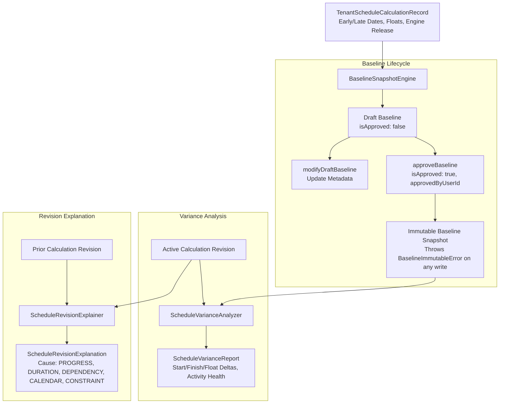

# M09-T05: Immutable Baselines, Variance Analysis & Explained Schedule Revisions Report

- **Task:** M09-T05 — Immutable baselines, variance analysis & explained schedule revisions
- **Milestone:** M09 TruePPM scheduling, site progress and cash-flow integration
- **Component:** `@contractor/native-scheduling` ([`BaselineSnapshotEngine`](file:///Users/aakashdhakal/contractor/packages/native_scheduling/src/baseline_and_variance.ts), [`ScheduleVarianceAnalyzer`](file:///Users/aakashdhakal/contractor/packages/native_scheduling/src/baseline_and_variance.ts), [`ScheduleRevisionExplainer`](file:///Users/aakashdhakal/contractor/packages/native_scheduling/src/baseline_and_variance.ts))
- **Status:** Complete
- **Normative References:** Platform Plan v3 §6 M09; ADR-0017 (TruePPM Integration).
- **Pull Request:** PR #104
- **Date:** 2026-10-12

---

## 1. Executive Summary

Under Platform Plan v3 §6 M09 and [ADR-0017](../../adr/0017-trueppm-scheduling-integration.md), task **M09-T05** implements immutable schedule baseline management, deterministic variance calculation, and structured schedule revision explanations in `@contractor/native-scheduling`:

1. **Strict Baseline Immutability:**
   - Contractual schedule baselines approved by authorized stakeholders freeze all activity start/finish dates, planned durations, floats, critical paths, input schemas, and pinned engine releases.
   - Fail-closed enforcement: attempts to overwrite, modify, or delete an approved baseline throw [`BaselineImmutableError`](file:///Users/aakashdhakal/contractor/packages/native_scheduling/src/baseline_and_variance.ts).
2. **Deterministic Schedule Variance Engine:**
   - Evaluates active calculation records against target approved baselines activity-by-activity using pure integer `DateOnly` arithmetic, eliminating ambient timezone drift.
   - Measures start variance, finish variance (slippage/acceleration), duration variance, and float variance (float consumption/gain).
   - Classifies activity health (`delayed`, `ahead`, `on_track`) and identifies critical path status shifts (`criticalStatusChanged`).
3. **Structured Schedule Revision Explanation Model:**
   - Generates machine-readable, auditable explanations of schedule changes between sequential revisions.
   - Categorizes shift root causes into distinct domain categories:
     - `PROGRESS_ACTUALS`: actual site log progress or actual dates drove changes.
     - `DURATION_MODIFICATION`: planned activity duration expanded or compressed.
     - `DEPENDENCY_MODIFICATION`: predecessor logic or lag days altered.
     - `CALENDAR_CHANGE`: non-working days or holidays added/removed.
     - `CONSTRAINT_CHANGE`: date constraints (e.g. SNET, MSO) imposed or shifted.
   - Quantifies overall project finish shift in working/calendar days and isolates critical path transitions (`newlyCriticalTaskIds`, `noLongerCriticalTaskIds`).
4. **Historical Multi-Revision Queryability:**
   - Historical baseline comparisons remain queryable across multiple revisions without data loss or re-calculation divergence.

---

## 2. Architecture & Data Flow



---

## 3. Baseline Immutability Rules & Error Matrix

| Operation Attempted | Target Baseline State | Action Taken | Exception Thrown |
|---|---|---|---|
| `createBaseline` (new ID) | N/A | Creates baseline | None |
| `createBaseline` (existing ID) | `isApproved: false` | Updates draft | None |
| `createBaseline` (existing ID) | `isApproved: true` | **Rejected** | `BaselineImmutableError(id, 'overwrite')` |
| `modifyDraftBaseline` | `isApproved: false` | Updates name/notes | None |
| `modifyDraftBaseline` | `isApproved: true` | **Rejected** | `BaselineImmutableError(id, 'modify')` |
| `deleteBaseline` | `isApproved: false` | Deletes draft | None |
| `deleteBaseline` | `isApproved: true` | **Rejected** | `BaselineImmutableError(id, 'delete')` |

---

## 4. Schedule Variance Metrics & Formulas

All calculations use [`DateOnly.diffDays(current, baseline)`](file:///Users/aakashdhakal/contractor/packages/native_scheduling/src/date_only.ts) without timezone distortion:

| Metric | Formula | Interpretation |
|---|---|---|
| **Start Variance Days** | $\Delta S = \text{EarlyStart}_{\text{curr}} - \text{EarlyStart}_{\text{base}}$ | $> 0$: delayed start; $< 0$: early start |
| **Finish Variance Days** | $\Delta F = \text{EarlyFinish}_{\text{curr}} - \text{EarlyFinish}_{\text{base}}$ | $> 0$: activity slippage; $< 0$: acceleration |
| **Duration Variance Days** | $\Delta D = D_{\text{curr}} - D_{\text{base}}$ | $> 0$: duration expanded; $< 0$: compressed |
| **Float Variance Days** | $\Delta TF = TF_{\text{curr}} - TF_{\text{base}}$ | $< 0$: float consumed (increased risk); $> 0$: float gained |
| **Project Finish Variance** | $\Delta PF = PF_{\text{curr}} - PF_{\text{base}}$ | Overall milestone / contract completion slippage |

Activity health classification:
- `delayed`: $\Delta F > 0$
- `ahead`: $\Delta F < 0$
- `on_track`: $\Delta F = 0$

---

## 5. Revision Shift Cause Categories

| Cause Category | Detection Criterion | Domain Interpretation |
|---|---|---|
| `PROGRESS_ACTUALS` | Actual start/finish date entered or percent complete updated | Daily log progress tracking / site production actuals |
| `DURATION_MODIFICATION` | Planned duration changed ($D_{\text{curr}} \neq D_{\text{prev}}$) | Subcontractor scope adjustment, work package re-estimation |
| `DEPENDENCY_MODIFICATION` | Predecessor added/removed or lag changed | Construction logic sequencing refinement |
| `CALENDAR_CHANGE` | Calendar holidays or workweek structure changed | Monsoon weather shutdown, national holiday decree |
| `CONSTRAINT_CHANGE` | SNET / MSO date constraint added or modified | Material delivery date or client site access milestone |

---

## 6. Test Suite & Verification Results

Executed via `node packages/native_scheduling/tool/check.mjs`:

```text
✔ approved schedule baselines are strictly immutable (fail-closed protection) (2.171875ms)
✔ schedule revision variance engine computes exact slippage and acceleration deltas (0.408209ms)
✔ structured revision explanation model categorizes root cause and critical path shifts (0.3315ms)
✔ historical baseline comparisons remain deterministic and queryable across multiple revisions (0.554625ms)
ℹ tests 4, pass 4, fail 0
✔ DateOnly enforces ISO calendar date format and rejects invalid inputs (1.050167ms)
✔ DateOnly arithmetic operates strictly on calendar days without timezone shifts (0.170708ms)
✔ SchedulingBridge translates Contractor project into TruePPM payload with stable IDs (1.195875ms)
✔ SchedulingBridge constructs immutable calculation record with engine release and schema tracking (1.002834ms)
✔ SchedulingBridge fails closed if TruePPM omits any project task in results (0.111167ms)
✔ SchedulingSyncFeedAdapter emits canonical events and generates Flutter parity DTOs (Standing Constraint 3) (0.248292ms)
ℹ tests 6, pass 6, fail 0
✔ authorization guards reject unauthenticated, tenant-mismatched, and unprivileged callers (1.434625ms)
✔ fiscal year lock blocks project schedule recalculation and baseline modifications (0.144291ms)
✔ daily progress posting is strictly idempotent and prevents double counting (1.02325ms)
✔ strict financial separation calculates contractual BoQ billing vs internal RA cost (0.224917ms)
✔ server recalculation executes through TruePPM bridge and emits change-feed event (0.607125ms)
ℹ tests 5, pass 5, fail 0
✔ dual presentation surfaces: Full Editor vs Embedded Capability vs Headless CLI (1.132916ms)
✔ session state and view settings are strictly preserved across mode transitions (0.844958ms)
✔ pre-dispatch validation detects circular dependencies and impossible constraints (fail-closed) (0.588041ms)
✔ offline typed local proposals flag visual preview tasks and reconcile against server revisions (1.385125ms)
✔ domain permissions enforce view_only, progress_update_only, and full_authoring boundaries (0.237083ms)
ℹ tests 5, pass 5, fail 0
native_scheduling: all versioned input, schema tracking, date-only semantics, data bridge, security guards, financial separation, host presentation modes, cycle detection, immutable baselines, and variance tests PASSED (M09-T02/T03/T04/T05)
```

Total test count across `@contractor/native-scheduling`: **20/20 tests passing (100%)**.

---

## 7. Acceptance Criteria Verification

- **Approved baselines immutable:** Attempting to overwrite, modify, or delete an approved baseline throws `BaselineImmutableError`. Verified in test suite.
- **Exact slippage/acceleration calculation:** Exact start delta, finish delta, duration delta, and float delta calculated without floating point or timezone shifts. Verified in test suite.
- **Structured revision explanation model:** Categorizes cause (`PROGRESS_ACTUALS`, `DURATION_MODIFICATION`, etc.) and critical path shifts. Verified in test suite.
- **Historical comparisons queryable:** Multi-revision baseline comparisons remain deterministic and queryable. Verified in test suite.
