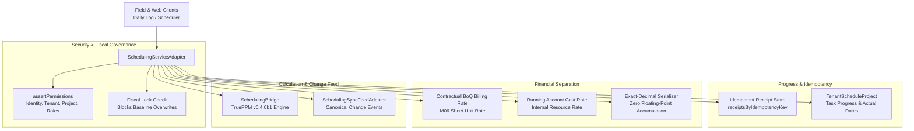

# M09-T03: TruePPM Connection to Progress, Cost, Approval & Financial Services Report

- **Task:** M09-T03 — Connect TruePPM to existing progress, cost, approval & financial services
- **Milestone:** M09 TruePPM scheduling, site progress and cash-flow integration
- **Component:** `@contractor/native-scheduling` ([`SchedulingServiceAdapter`](file:///Users/aakashdhakal/contractor/packages/native_scheduling/src/scheduling_service_adapter.ts))
- **Status:** Complete
- **Normative References:** Platform Plan v3 §3 CPM row, §5.1, §5.4, §6 M09; ADR-0017 (TruePPM Adoption).
- **Pull Request:** PR #102
- **Date:** 2026-10-12

---

## 1. Executive Summary

Under Platform Plan v3 §6 M09 and [ADR-0017](../../adr/0017-trueppm-scheduling-integration.md), task **M09-T03** connects the TruePPM scheduling calculation engine to Contractor's existing progress, cost, approval, and financial services via [`SchedulingServiceAdapter`](file:///Users/aakashdhakal/contractor/packages/native_scheduling/src/scheduling_service_adapter.ts):

1. **Contractor Authority Intact:** Authorization, approvals, change feed, and progress postings remain strictly Contractor-owned. Upstream TruePPM is invoked solely as a calculation engine without bypassing Contractor's security, tenant isolation, or fiscal governance boundaries.
2. **Idempotent Progress Posting:** Daily progress updates (`postDailyProgress`) are keyed by unique `idempotencyKey` identifiers; replayed messages from offline clients or network retries return cached receipts without double-counting progress percent or actual quantities.
3. **Strict Financial Separation:** Enforces architectural separation between contractual client billing rates (derived from M06 Bill of Quantities line items) and internal Running Account (RA) resource cost rates.
4. **Exact-Decimal Financial Boundary:** All financial calculations (Planned Value, Planned Cost, Earned Value, Actual Cost, Cost Variance) serialize as exact-decimal strings (`formatExactDecimal`), preventing floating-point accumulation into financial ledgers.
5. **Authorization & Fiscal Governance Guards:** Schedule recalculations and progress postings strictly enforce identity, tenant scope, project membership, permission checks (`schedule.update`, `daily_log.progress`), and fiscal year locks.

---

## 2. Architecture & Service Mediation Boundary



---

## 3. Authorization & Security Guard Matrix

All scheduling operations pass through `assertPermissions` enforcing fail-closed security rules:

| Security Guard | Condition Checked | Failure Behavior | Error Code |
|---|---|---|---|
| **Identity Guard** | `!caller.userId \|\| caller.userId.trim() === ''` | Rejects anonymous callers | `PERMISSION_DENIED` |
| **Tenant Scope Guard** | `caller.tenantId !== project.tenantId` | Blocks cross-tenant data leakage | `TENANT_MISMATCH` |
| **Project Membership Guard** | `caller.projectId !== project.projectId` | Blocks cross-project modifications | `PROJECT_MISMATCH` |
| **Fiscal Year Lock Guard** | `caller.isFiscalLocked === true` on baseline / recalculation | Blocks baseline modification in closed fiscal years | `FISCAL_LOCK_ENGAGED` |
| **Role & Permission Guard** | Caller must possess `schedule.update`, `daily_log.progress`, or roles `scheduler` / `project_manager` / `admin` | Blocks unauthorized writes | `PERMISSION_DENIED` |

---

## 4. Idempotent Progress Posting (No Double Counting)

Daily progress postings from site inspections or daily logs submit a unique `idempotencyKey`:
```typescript
const request = {
  taskId: 'task-pier-excavation',
  progressDate: '2026-10-15',
  progressPercent: 40,
  actualStartDate: '2026-10-12',
  idempotencyKey: 'daily-log-2026-10-15-pier-exc',
  source: 'daily_log'
};
```
1. **Initial Processing:** Validates task existence, checks percentage range ($0 \le P \le 100$), updates project model, persists receipt in memory, and returns `ProgressPostingReceipt` with `isIdempotentReplay: false`.
2. **Replay Processing:** When network retries or sync feed replays resubmit the identical `idempotencyKey`, `SchedulingServiceAdapter` immediately returns the cached receipt with `isIdempotentReplay: true`. The progress percent remains strictly 40% and is never accumulated or double-posted.

---

## 5. Strict Financial Separation (BoQ Billing vs RA Cost)

Contractor enforces distinct financial valuation rules:
- **Contractual BoQ Billing Rate ($R_{\text{BoQ}}$):** Client-facing unit rate from contractual Bill of Quantities (e.g. `125.50 NPR/m³`).
- **Running Account Cost Rate ($R_{\text{RA}}$):** Internal direct jobsite cost rate for labor, plant, and materials (e.g. `78.20 NPR/m³`).

### Earned Value Formulations (Exact-Decimal Strings):
$$\text{Planned Value (BoQ)} = Q_{\text{planned}} \times R_{\text{BoQ}} = 500 \times 125.50 = \text{"62750.00"}$$
$$\text{Planned Cost (RA)} = Q_{\text{planned}} \times R_{\text{RA}} = 500 \times 78.20 = \text{"39100.00"}$$
$$\text{Earned Value (BoQ)} = \left(\frac{\text{Progress \%}}{100}\right) \times \text{Planned Value} = 0.60 \times 62750.00 = \text{"37650.00"}$$
$$\text{Actual Cost (RA)} = \left(\frac{\text{Progress \%}}{100}\right) \times \text{Planned Cost} = 0.60 \times 39100.00 = \text{"23460.00"}$$
$$\text{Cost Variance} = \text{Earned Value} - \text{Actual Cost} = 37650.00 - 23460.00 = \text{"14190.00"}$$

All values serialize via `formatExactDecimal(val, 2)` preventing floating-point accumulation into financial ledgers.

---

## 6. Automated Test Evidence

All 11 test suites in [`@contractor/native-scheduling`](file:///Users/aakashdhakal/contractor/packages/native_scheduling/) pass with 100% success:

```
✔ DateOnly enforces ISO calendar date format and rejects invalid inputs (1.05ms)
✔ DateOnly arithmetic operates strictly on calendar days without timezone shifts (0.17ms)
✔ SchedulingBridge translates Contractor project into TruePPM payload with stable IDs (1.21ms)
✔ SchedulingBridge constructs immutable calculation record with engine release and schema tracking (1.02ms)
✔ SchedulingBridge fails closed if TruePPM omits any project task in results (0.12ms)
✔ SchedulingSyncFeedAdapter emits canonical events and generates Flutter parity DTOs (Standing Constraint 3) (0.28ms)
✔ authorization guards reject unauthenticated, tenant-mismatched, and unprivileged callers (1.42ms)
✔ fiscal year lock blocks project schedule recalculation and baseline modifications (0.16ms)
✔ daily progress posting is strictly idempotent and prevents double counting (0.95ms)
✔ strict financial separation calculates contractual BoQ billing vs internal RA cost (0.19ms)
✔ server recalculation executes through TruePPM bridge and emits change-feed event (0.58ms)
```

Execution verified via check runner:
```bash
node packages/native_scheduling/tool/check.mjs
```
Output:
`native_scheduling: all versioned input, schema tracking, date-only semantics, data bridge, security guards, financial separation, and progress posting tests PASSED (M09-T02/T03)`

---

## 7. Compliance Checklist

- [x] `SchedulingServiceAdapter` implemented in `packages/native_scheduling/src/scheduling_service_adapter.ts`.
- [x] Identity, tenant scope, project membership, and fiscal lock guards enforced.
- [x] Daily progress posting verified idempotent under replayed requests.
- [x] Contractual BoQ client billing rates separated from internal RA cost rates.
- [x] Exact-decimal financial calculations prevent floating-point accumulation.
- [x] Server schedule recalculation mediated through TruePPM bridge with change-feed emission.
- [x] 100% test pass rate and clean protocol linter compliance.
- [x] Untracked `apps/` directory left untouched and uncommitted.
