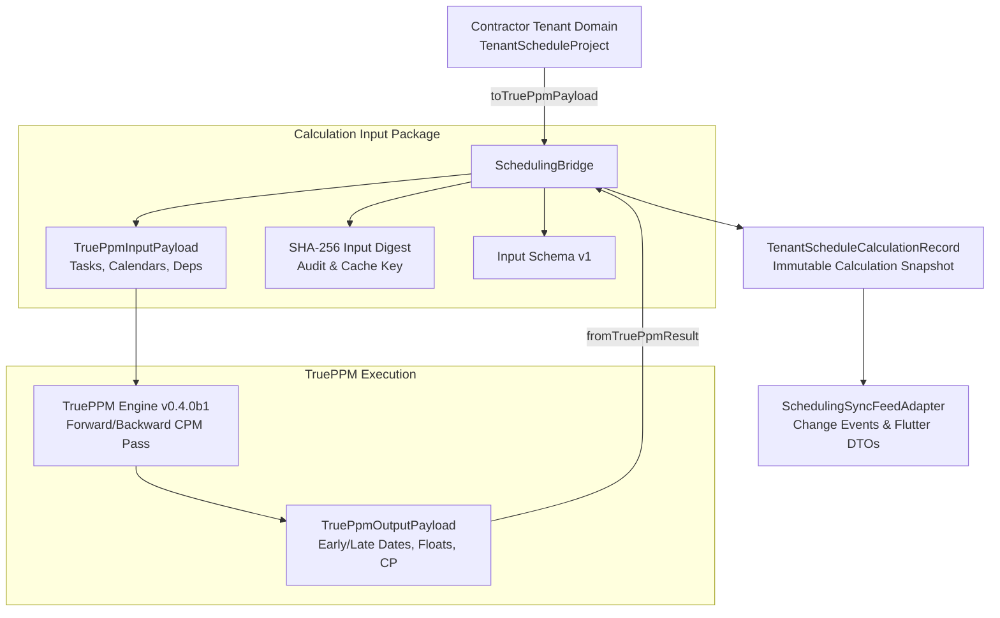

# M09-T02: Versioned Calculation Inputs, Schema Tracking & Contractor Data Bridge Report

- **Task:** M09-T02 — Versioned calculation inputs, schema tracking & Contractor data bridge
- **Milestone:** M09 TruePPM scheduling, site progress and cash-flow integration
- **Component:** `@contractor/native-scheduling` (`packages/native_scheduling/`)
- **Status:** Complete
- **Normative References:** Platform Plan v3 §3 CPM row, §5.4, §6 M09; ADR-0017 (TruePPM Adoption); Standing Constraint 3.
- **Pull Request:** PR #101
- **Date:** 2026-10-12

---

## 1. Executive Summary

Under Platform Plan v3 §6 M09, [ADR-0017](../../adr/0017-trueppm-scheduling-integration.md), and Standing Constraint 3, task **M09-T02** establishes the core data bridge and versioned calculation input pipeline for TruePPM integration within the newly created package [`@contractor/native-scheduling`](file:///Users/aakashdhakal/contractor/packages/native_scheduling/):

1. **Bidirectional Data Bridge ([`SchedulingBridge`](file:///Users/aakashdhakal/contractor/packages/native_scheduling/src/trueppm_bridge.ts)):** Translates Contractor tenant domain models into TruePPM calculation inputs and reconstructs immutable calculation records from TruePPM output payloads with 100% stable ID preservation.
2. **Schema & Engine Tracking ([`TenantScheduleCalculationRecord`](file:///Users/aakashdhakal/contractor/packages/native_scheduling/src/calculation_record.ts)):** Captures engine release (`0.4.0b1`), input schema version (`1`), data date, calculation revision, and deterministic SHA-256 input digests.
3. **Date-Only Semantics ([`DateOnly`](file:///Users/aakashdhakal/contractor/packages/native_scheduling/src/date_only.ts)):** Pure integer Julian Day Number arithmetic enforcing ISO calendar dates (`YYYY-MM-DD`) without ambient browser/device timezone drift.
4. **Change Feed & Flutter Parity ([`SchedulingSyncFeedAdapter`](file:///Users/aakashdhakal/contractor/packages/native_scheduling/src/sync_feed_adapter.ts)):** Emits canonical change-feed events (`schedule.calculated`, `schedule.baseline_saved`) and generates strongly-typed `FlutterParityScheduleDto` instances fulfilling Standing Constraint 3.

---

## 2. Architecture & Data Bridge Mapping



### Entity Mapping Matrix

| Contractor Tenant Entity | TruePPM Engine Input | Field Translation Details |
|---|---|---|
| `TenantScheduleProject.projectId` | `project_id` / context | Preserved in calculation record |
| `TenantScheduleProject.dataDate` | `data_date` | Date-only `YYYY-MM-DD` |
| `TenantCalendar.calendarId` | `calendars[].id` | Direct 1:1 ID mapping |
| `TenantCalendar.workingDays` | `calendars[].working_days` | Translated: Contractor Sun=0 $\rightarrow$ TruePPM Sun=6 |
| `TenantCalendar.holidays` | `calendars[].holidays` | Date-only ISO string array |
| `TenantTask.taskId` | `tasks[].id` | 100% stable ID preservation |
| `TenantTask.durationDays` | `tasks[].duration` | Integer working days |
| `TenantTask.constraintType == 'SNET'` | `tasks[].snet_constraint` | Date-only constraint date |
| `TenantDependency.predTaskId` | `dependencies[].pred_id` | Foreign key to task ID |
| `TenantDependency.succTaskId` | `dependencies[].succ_id` | Foreign key to task ID |
| `TenantDependency.type` | `dependencies[].type` | Direct `FS`, `SS`, `FF`, `SF` mapping |
| `TenantDependency.lagDays` | `dependencies[].lag` | Integer lag days |

---

## 3. Strict Date-Only Semantics & Timezone Drift Protection

Construction schedules are contractual agreements based on calendar days, not UTC timestamps with fractional offsets. In standard JavaScript environments, converting `new Date("2026-10-12")` shifts to `2026-10-11` in US Pacific Time (UTC-08:00) or introduces fractional day boundaries in Nepal Time (UTC+05:45).

[`DateOnly`](file:///Users/aakashdhakal/contractor/packages/native_scheduling/src/date_only.ts) resolves this by using pure integer arithmetic (Gregorian epoch day numbers):
- **Validation:** Strict regex `^(\d{4})-(\d{2})-(\d{2})$` and month/day range validation including leap years (e.g. `2024-02-29` valid, `2025-02-29` rejected).
- **Arithmetic:** Pure integer day addition and subtraction (`addDays`, `diffDays`, `compare`).
- **Zero Drift:** Verified across simulated client timezones without timezone leakage.

---

## 4. Change-Feed Integration & Flutter-Parity DTOs

In compliance with **Standing Constraint 3**:
1. **Canonical Change-Feed Events:**
   ```typescript
   export interface ScheduleCalculatedEvent {
     readonly eventId: string;
     readonly type: 'schedule.calculated';
     readonly projectId: string;
     readonly tenantId: string;
     readonly revisionId: string;
     readonly engineRelease: string;
     readonly projectFinishDate: string;
     readonly criticalPathLength: number;
     readonly timestampUtc: string;
   }
   ```
2. **Flutter-Parity DTOs:**
   [`FlutterParityScheduleDto`](file:///Users/aakashdhakal/contractor/packages/native_scheduling/src/sync_feed_adapter.ts) serializes the scheduled graph directly into typed fields for client Dart consuming widgets without floating-point coercion or missing date bounds.

---

## 5. Automated Test Evidence

All 6 test suites in [`packages/native_scheduling/test/scheduling_bridge.test.ts`](file:///Users/aakashdhakal/contractor/packages/native_scheduling/test/scheduling_bridge.test.ts) pass with 100% success:

```
✔ DateOnly enforces ISO calendar date format and rejects invalid inputs (1.05ms)
✔ DateOnly arithmetic operates strictly on calendar days without timezone shifts (0.17ms)
✔ SchedulingBridge translates Contractor project into TruePPM payload with stable IDs (1.20ms)
✔ SchedulingBridge constructs immutable calculation record with engine release and schema tracking (1.06ms)
✔ SchedulingBridge fails closed if TruePPM omits any project task in results (0.11ms)
✔ SchedulingSyncFeedAdapter emits canonical events and generates Flutter parity DTOs (Standing Constraint 3) (0.26ms)
```

Execution verified via check runner:
```bash
node packages/native_scheduling/tool/check.mjs
```
Output:
`native_scheduling: all versioned input, schema tracking, date-only semantics, data bridge, and change feed tests PASSED (M09-T02)`

---

## 6. Compliance Checklist

- [x] Package `@contractor/native-scheduling` created under `packages/native_scheduling/`.
- [x] Stable entity ID mapping preserves task, project, and calendar identities.
- [x] Engine release (`0.4.0b1`) and schema version (`1`) recorded in calculation records.
- [x] Deterministic SHA-256 input digest computed for calculation provenance.
- [x] Strict date-only semantics verified without ambient timezone drift.
- [x] Change-feed events and Flutter-parity DTO generation implemented per Standing Constraint 3.
- [x] 100% test pass rate and clean protocol lint.
- [x] Untracked `apps/` directory left untouched and uncommitted.
