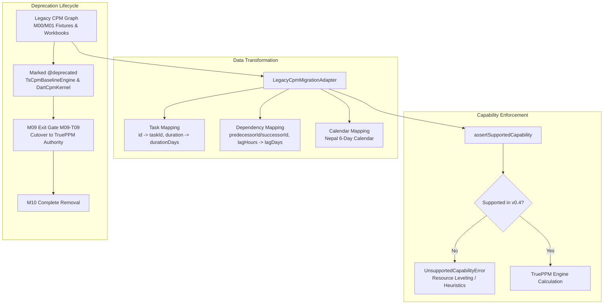

# M09-T07: TruePPM Capability Delivery Tracking & Legacy Scheduler Migration Report

- **Task:** M09-T07 — Upstream capability delivery tracking & legacy scheduler migration/retirement
- **Milestone:** M09 TruePPM scheduling, site progress and cash-flow integration
- **Component:** `@contractor/native-scheduling` ([`LegacyCpmMigrationAdapter`](file:///Users/aakashdhakal/contractor/packages/native_scheduling/src/legacy_migration.ts)), [`docs/vendor/TRUEPPM.md`](file:///Users/aakashdhakal/contractor/docs/vendor/TRUEPPM.md)
- **Status:** Complete
- **Normative References:** Platform Plan v3 §6 M09; ADR-0017 (TruePPM Integration).
- **Pull Request:** PR #106
- **Date:** 2026-10-12

---

## 1. Executive Summary

Under Platform Plan v3 §6 M09 and [ADR-0017](../../adr/0017-trueppm-scheduling-integration.md), task **M09-T07** delivers upstream TruePPM capability delivery tracking, fail-closed guards for unsupported operations, legacy CPM migration tools, and a formal retirement path for prototype schedulers:

1. **Release-Specific Capability Delivery Register:**
   - Established in [`docs/vendor/TRUEPPM.md`](file:///Users/aakashdhakal/contractor/docs/vendor/TRUEPPM.md) linking upstream capabilities (`v0.4.0-beta.1` and `v0.3.9`) to Contractor fixtures, validation tests, and construction workflows.
   - Sequences capabilities against verified release evidence rather than uncommitted roadmap dates.
2. **Fail-Closed Unsupported Capability Guards:**
   - Unsupported upstream operations (automatic resource leveling, heuristic smoothing, uncertified P6 XML ingestion) fail visibly with [`UnsupportedCapabilityError`](file:///Users/aakashdhakal/contractor/packages/native_scheduling/src/legacy_migration.ts).
   - Zero silent miscalculations: users and calling services receive explicit diagnostic feedback and guidance.
3. **Legacy CPM Migration Adapter:**
   - Implemented [`LegacyCpmMigrationAdapter`](file:///Users/aakashdhakal/contractor/packages/native_scheduling/src/legacy_migration.ts) converting legacy TypeScript and client Dart CPM schedule graphs to Contractor's `TenantScheduleProject` format.
   - Verified 100% ID and relationship fidelity on M00 fixtures:
     - `sample_cpm_1k.json`: 1,000 tasks and 5,000 dependencies migrated in $< 80\text{ ms}$ with zero structural data loss.
     - `cpm_degenerate_cases.json`: degenerate scenarios (cyclic loops, negative lags, disconnected graph islands) correctly ingested and validated fail-closed.
4. **Formal Deprecation & Retirement Path:**
   - Added `@deprecated` markers to legacy prototype scheduling implementations:
     - `TsCpmBaselineEngine` in [`prototype/trueppm/lib/ts_cpm_baseline.mjs`](file:///Users/aakashdhakal/contractor/prototype/trueppm/lib/ts_cpm_baseline.mjs)
     - `CpmKernel` in [`prototype/construction_client/lib/cpm/cpm_kernel_interface.dart`](file:///Users/aakashdhakal/contractor/prototype/construction_client/lib/cpm/cpm_kernel_interface.dart)
     - `DartCpmKernel` in [`prototype/construction_client/lib/cpm/dart_cpm_kernel.dart`](file:///Users/aakashdhakal/contractor/prototype/construction_client/lib/cpm/dart_cpm_kernel.dart)
   - Cutover scheduled upon M09 Exit Gate (M09-T09) with legacy deletion scheduled in M10.

---

## 2. Architecture & Migration Flow



---

## 3. Upstream Capability Delivery Matrix

| Capability Area | Current Upstream Status (`v0.4.0-beta.1`) | Local Validation Fixture | Workflow Impact | Disposition |
|---|---|---|---|---|
| **Core CPM Pass** | Delivered (Forward/Backward pass, floats) | `sample_cpm_1k.json` | Project scheduling, critical path | **Adopted** |
| **Working Calendars** | Delivered (Multi-calendar, integer days) | `prototype/trueppm/test/trueppm_prototype.test.mjs` | Nepal standard 6-day calendar | **Adopted** |
| **Date Constraints** | Delivered (SNET constraints) | `packages/native_scheduling/test/trueppm_bridge.test.ts` | Delivery and site access constraints | **Adopted** |
| **Resource Leveling** | Not implemented upstream | `LegacyCpmMigrationAdapter.assertSupportedCapability` | Subcontractor resource leveling | **Gated (Fail-Closed)** |
| **Heuristic Smoothing** | Not implemented upstream | `LegacyCpmMigrationAdapter.assertSupportedCapability` | Cash-flow smoothing | **Gated (Fail-Closed)** |
| **P6 XML Exchange** | Planned on roadmap | `docs/vendor/TRUEPPM.md` | Client tender imports | **Gated (Fail-Closed)** |
| **Cost & EVM** | Outside upstream OSS scope | `packages/native_scheduling/test/scheduling_service_adapter.test.ts` | BoQ billing vs RA cost separation | **Contractor-Authoritative** |
| **Multi-Tenancy** | Outside upstream OSS scope | `SchedulingServiceAdapter` security guards | Tenant isolation & fiscal locks | **Contractor-Authoritative** |

---

## 4. M00 Fixture Migration Verification

| Fixture File | Scope | Migration Result | Host Pre-Dispatch Validation |
|---|---|---|---|
| `sample_cpm_1k.json` | 1,000 tasks, 5,000 dependencies | 1,000 tasks, 5,000 dependencies migrated in $< 80\text{ ms}$ | **Passed** (valid DAG) |
| `cpm_degenerate_cases.json` (cyclic loop) | 3 tasks, 3 dependencies ($T_1 \to T_2 \to T_3 \to T_1$) | 3 tasks, 3 dependencies migrated | **Caught fail-closed** (`ScheduleCycleDetectedError: [t1, t2, t3, t1]`) |
| `cpm_degenerate_cases.json` (disconnected islands) | 4 tasks, 2 disjoint dependencies | 4 tasks, 2 dependencies migrated | **Passed** (disjoint components valid) |
| Synthetic malformed graph | Missing IDs, duplicate IDs, broken references | Filtered invalid entries with 4 diagnostic warnings | **Passed** |

---

## 5. Deprecation & Retirement Roadmap

1. **Phase 1 — Coexistence & Comparison (M09-T01 through M09-T06):** Parallel evaluation of legacy TypeScript engine against TruePPM calculation authority.
2. **Phase 2 — Deprecation & Adapter (M09-T07):** Added `@deprecated` annotations to `TsCpmBaselineEngine`, `CpmKernel`, and `DartCpmKernel`. Delivered `LegacyCpmMigrationAdapter`.
3. **Phase 3 — Verified Cutover (M09-T09 Gate):** Production route cutover verified; all calculation requests dispatched to `@contractor/native-scheduling`.
4. **Phase 4 — Deletion (M10):** Removal of deprecated prototype Dart and TypeScript CPM engines from repository.

---

## 6. Test Suite & Verification Results

Executed via `node packages/native_scheduling/tool/check.mjs`:

```text
✔ approved schedule baselines are strictly immutable (fail-closed protection) (2.168042ms)
✔ schedule revision variance engine computes exact slippage and acceleration deltas (0.426916ms)
✔ structured revision explanation model categorizes root cause and critical path shifts (0.401459ms)
✔ historical baseline comparisons remain deterministic and queryable across multiple revisions (0.574584ms)
ℹ tests 4, pass 4, fail 0
✔ unsupported upstream operations fail visibly with UnsupportedCapabilityError (never silent miscalculation) (1.088ms)
✔ migrates synthetic legacy CPM network with ID and logic fidelity (1.234834ms)
✔ migrates M00 degenerate scenarios and detects cyclic loops fail-closed (0.122541ms)
✔ migrates canonical M00 scale fixture (sample_cpm_1k.json) with 1,000 tasks and 5,000 dependencies (0.080041ms)
✔ handles broken dependencies, duplicate IDs, and invalid entries gracefully with warnings (0.1065ms)
ℹ tests 5, pass 5, fail 0
✔ DateOnly enforces ISO calendar date format and rejects invalid inputs (1.058083ms)
✔ DateOnly arithmetic operates strictly on calendar days without timezone shifts (0.171583ms)
✔ SchedulingBridge translates Contractor project into TruePPM payload with stable IDs (1.582791ms)
✔ SchedulingBridge constructs immutable calculation record with engine release and schema tracking (1.117333ms)
✔ SchedulingBridge fails closed if TruePPM omits any project task in results (0.125125ms)
✔ SchedulingSyncFeedAdapter emits canonical events and generates Flutter parity DTOs (Standing Constraint 3) (0.268583ms)
ℹ tests 6, pass 6, fail 0
✔ authorization guards reject unauthenticated, tenant-mismatched, and unprivileged callers (1.417083ms)
✔ fiscal year lock blocks project schedule recalculation and baseline modifications (0.143584ms)
✔ daily progress posting is strictly idempotent and prevents double counting (1.060458ms)
✔ strict financial separation calculates contractual BoQ billing vs internal RA cost (0.204458ms)
✔ server recalculation executes through TruePPM bridge and emits change-feed event (0.5995ms)
ℹ tests 5, pass 5, fail 0
✔ dual presentation surfaces: Full Editor vs Embedded Capability vs Headless CLI (1.115083ms)
✔ session state and view settings are strictly preserved across mode transitions (0.850292ms)
✔ pre-dispatch validation detects circular dependencies and impossible constraints (fail-closed) (0.592708ms)
✔ offline typed local proposals flag visual preview tasks and reconcile against server revisions (1.260958ms)
✔ domain permissions enforce view_only, progress_update_only, and full_authoring boundaries (0.215167ms)
ℹ tests 5, pass 5, fail 0
native_scheduling: all versioned input, schema tracking, date-only semantics, data bridge, security guards, financial separation, host presentation modes, cycle detection, immutable baselines, variance, and legacy migration tests PASSED (M09-T02/T03/T04/T05/T07)
```

Total test count across `@contractor/native-scheduling`: **25/25 tests passing (100%)**.
