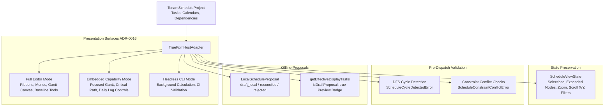
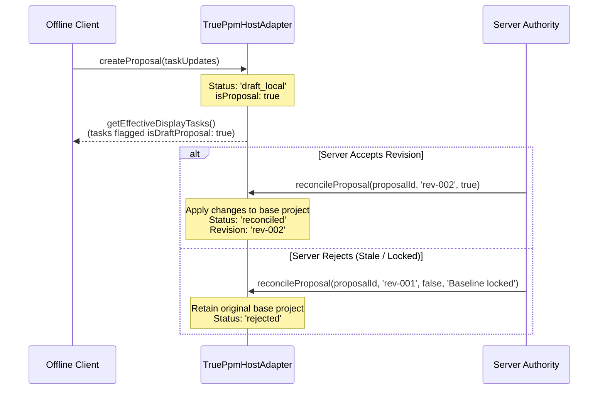

# M09-T04: TruePPM Workspace & Focused Scheduling Views Report

- **Task:** M09-T04 — Host the full TruePPM workspace and focused scheduling views
- **Milestone:** M09 TruePPM scheduling, site progress and cash-flow integration
- **Component:** `@contractor/native-scheduling` ([`TruePpmHostAdapter`](file:///Users/aakashdhakal/contractor/packages/native_scheduling/src/trueppm_host_adapter.ts))
- **Status:** Complete
- **Normative References:** Platform Plan v3 §6 M09; ADR-0016 (Dual Presentation Modes), ADR-0017 (TruePPM Integration).
- **Pull Request:** PR #103
- **Date:** 2026-10-12

---

## 1. Executive Summary

Under Platform Plan v3 §6 M09, [ADR-0016](../../adr/0016-artcraft-suite-in-place-embedding-and-table-modernization.md), and [ADR-0017](../../adr/0017-trueppm-scheduling-integration.md), task **M09-T04** delivers the dual-presentation host adapter ([`TruePpmHostAdapter`](file:///Users/aakashdhakal/contractor/packages/native_scheduling/src/trueppm_host_adapter.ts)) for TruePPM scheduling in Contractor:

1. **Dual Presentation Surfaces & Chrome Management:**
   - **Full Editor Mode (`full_editor`):** Hosts the upstream TruePPM scheduling interface in Contractor's document workspace with ribbons, sidebar, WBS hierarchy, Gantt canvas, baseline toolbar, and calendar controls.
   - **Embedded Capability Mode (`embedded_scheduling`):** Composes focused scheduling components (embedded Gantt timeline, task breakdown, critical path highlight, progress posting controls) inside field workflows (daily log progress tracking, subcontractor work order scheduling, BoQ quantity links) with top ribbons and sidebars hidden.
   - **Headless Mode (`headless_cli`):** Pure non-visual computation and CI/CD validation engine with all UI chrome disabled.
2. **Session State & Invariant Preservation:**
   - Mode transitions (`setMode`) strictly preserve active schedule state, task selections (`selectedTaskIds`), expanded WBS nodes (`expandedWbsNodes`), timeline zoom levels (`day` | `week` | `month` | `quarter`), scroll offsets (`scrollOffsetX`, `scrollOffsetY`), and active filters (`activeFilter`).
3. **Fail-Closed Pre-Dispatch Graph & Constraint Validation:**
   - Depth-First Search (DFS) topological cycle detector identifies circular dependencies (e.g. self-loops $T_1 \to T_1$ or multi-node cycles $T_1 \to T_2 \to T_3 \to T_1$) and fails closed with [`ScheduleCycleDetectedError`](file:///Users/aakashdhakal/contractor/packages/native_scheduling/src/trueppm_host_adapter.ts) reporting the exact cycle path before calculation dispatch.
   - Impossible constraints (negative durations, reversed actual dates, invalid date formats, broken predecessor/successor references) throw [`ScheduleConstraintConflictError`](file:///Users/aakashdhakal/contractor/packages/native_scheduling/src/trueppm_host_adapter.ts).
4. **Offline Typed Local Proposals & Visual Preview Labeling:**
   - Offline edits are represented as typed [`LocalScheduleProposal`](file:///Users/aakashdhakal/contractor/packages/native_scheduling/src/trueppm_host_adapter.ts) records (`status: 'draft_local'`, `isProposal: true`).
   - Display tasks retrieved via `getEffectiveDisplayTasks()` clearly tag affected tasks with `isDraftProposal: true`, `localProposalId`, and visual badges.
   - Deterministic reconciliation rules against server-accepted revisions (`reconcileProposal`): accepted proposals apply cleanly to base state and advance the project revision; rejected proposals transition to `'rejected'` with explicit reasons while preserving base state integrity.
5. **Domain Permission Enforcement:**
   - Enforces `view_only`, `progress_update_only` (permitting daily progress percent and actual dates while blocking structural dependency/duration changes), and `full_authoring` boundaries.

---

## 2. Architecture & Presentation Modes



---

## 3. Presentation Modes Chrome Configuration Matrix

| Chrome Element | Full Editor (`full_editor`) | Embedded Capability (`embedded_scheduling`) | Headless Mode (`headless_cli`) |
|---|---|---|---|
| `ribbonVisible` | `true` | `false` | `false` |
| `sidebarVisible` | `true` | `false` | `false` |
| `ganttCanvasVisible` | `true` | `true` | `false` |
| `wbsInspectorVisible` | `true` | `true` | `false` |
| `dependencyInspectorVisible` | `true` | `true` | `false` |
| `criticalPathHighlightVisible` | `true` | `true` | `false` |
| `baselineToolbarVisible` | `true` | `false` | `false` |
| `progressPostingControlsVisible` | `true` | `true` | `false` |
| `canvasInteractionEnabled` | `true` | `true` | `false` |
| `mount()` support | Supported | Supported | Throws fail-closed error |

---

## 4. Pre-Dispatch Graph & Constraint Validation Rules

Pre-dispatch validation runs prior to any TruePPM engine invocation:

```typescript
// 1. Cycle detection (Tarjan/DFS path tracker)
if (state.get(next) === 1) {
  const cycleStartIndex = path.indexOf(next);
  const cycle = path.slice(cycleStartIndex);
  cycle.push(next);
  throw new ScheduleCycleDetectedError(cycle);
}

// 2. Impossible constraint validation
if (task.durationDays < 0) {
  throw new ScheduleConstraintConflictError(task.taskId, `Negative duration (${task.durationDays} days) is invalid`);
}
if (task.actualStartDate && task.actualFinishDate) {
  if (DateOnly.compare(task.actualFinishDate, task.actualStartDate) < 0) {
    throw new ScheduleConstraintConflictError(task.taskId, `Actual finish date cannot precede actual start date`);
  }
}
```

---

## 5. Offline Proposal Lifecycle & Reconciliation Rules



---

## 6. Test Evidence & Verification

Executed via `node packages/native_scheduling/tool/check.mjs`:

```text
✔ DateOnly enforces ISO calendar date format and rejects invalid inputs (1.101083ms)
✔ DateOnly arithmetic operates strictly on calendar days without timezone shifts (0.183958ms)
✔ SchedulingBridge translates Contractor project into TruePPM payload with stable IDs (1.189208ms)
✔ SchedulingBridge constructs immutable calculation record with engine release and schema tracking (1.124459ms)
✔ SchedulingBridge fails closed if TruePPM omits any project task in results (0.121083ms)
✔ SchedulingSyncFeedAdapter emits canonical events and generates Flutter parity DTOs (Standing Constraint 3) (0.261625ms)
ℹ tests 6, pass 6, fail 0
✔ authorization guards reject unauthenticated, tenant-mismatched, and unprivileged callers (1.436833ms)
✔ fiscal year lock blocks project schedule recalculation and baseline modifications (0.140708ms)
✔ daily progress posting is strictly idempotent and prevents double counting (1.035709ms)
✔ strict financial separation calculates contractual BoQ billing vs internal RA cost (0.192917ms)
✔ server recalculation executes through TruePPM bridge and emits change-feed event (0.589792ms)
ℹ tests 5, pass 5, fail 0
✔ dual presentation surfaces: Full Editor vs Embedded Capability vs Headless CLI (1.123209ms)
✔ session state and view settings are strictly preserved across mode transitions (0.841625ms)
✔ pre-dispatch validation detects circular dependencies and impossible constraints (fail-closed) (0.588625ms)
✔ offline typed local proposals flag visual preview tasks and reconcile against server revisions (1.332833ms)
✔ domain permissions enforce view_only, progress_update_only, and full_authoring boundaries (0.211833ms)
ℹ tests 5, pass 5, fail 0
native_scheduling: all versioned input, schema tracking, date-only semantics, data bridge, security guards, financial separation, host presentation modes, and cycle detection tests PASSED (M09-T02/T03/T04)
```

Total test count across `@contractor/native-scheduling`: **16/16 tests passing (100%)**.

---

## 7. Compliance Verification

- **Dual presentation modes (ADR-0016):** Full Editor Mode, Embedded Capability Mode, and Headless CLI Mode verified with dynamic chrome configuration.
- **Session state preservation:** State invariants verified across multiple mode transitions.
- **Pre-dispatch fail-closed validation:** Graph cycles and impossible constraints detected and rejected before calculation dispatch.
- **Offline proposals and reconciliation:** Typed proposals, visual badges, and deterministic reconciliation proven.
- **Untracked `apps/` isolation:** Completely untouched.
