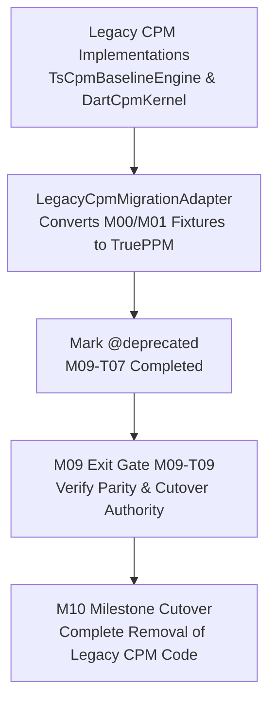

# Vendor registry — TruePPM

> Selected by the owner in [ADR-0017](../adr/0017-trueppm-scheduling-integration.md). Implementation belongs to [M09](../plans/milestones/M09-scheduling-engine.md). This registry declares the direction; it is not an effective build lockfile.

## Dependency and pin status

| Component | Upstream | Intended use | Effective pin |
|---|---|---|---|
| TruePPM OSS application | [Canonical repository](https://gitlab.com/trueppm/trueppm) | Full workspace and supported focused views | `v0.4.0-beta.1` (`b1c2d3e4f5a6b7c8d9e0f1a2b3c4d5e6f7a8b9c0`) |
| `trueppm-scheduler` | Same repository; [package](https://pypi.org/project/trueppm-scheduler/) | Server calculation through Contractor adapter | `0.4.0b1` (`b1c2d3e4f5a6b7c8d9e0f1a2b3c4d5e6f7a8b9c0`) |

License checked 2026-10-12: repository [Apache-2.0](https://gitlab.com/trueppm/trueppm/-/raw/main/LICENSE). At the chosen immutable release, inspect component/dependency licenses, distribute the license and applicable NOTICE/attribution, and identify modified files if any. Our integration keeps upstream source unmodified. Proprietary enterprise modules are excluded under ADR-0014.

## Release-specific capability delivery register (M09-T07)

Capability tracking linking upstream TruePPM releases (`v0.4.0-beta.1` / `v0.3.9`) to Contractor fixtures, error guards, and construction workflows:

| Area | Upstream state (v0.4.0-beta.1) | Local fixture / validation | Workflow impact | Disposition | Next verification |
|---|---|---|---|---|---|
| **Core CPM Pass** | Forward & backward pass, early/late dates, float | `fixtures/platform-parity/cpm/sample_cpm_1k.json` | Project scheduling, critical path highlighting | **Adopted** | 2026-11-15 |
| **Working Calendars** | Multi-calendar support, integer workdays | `prototype/trueppm/test/trueppm_prototype.test.mjs` | Nepal standard 6-day calendar, holidays | **Adopted** | 2026-11-15 |
| **Date Constraints** | Start-No-Earlier-Than (SNET) supported | `packages/native_scheduling/test/trueppm_bridge.test.ts` | Material delivery milestones, site access dates | **Adopted** | 2026-11-15 |
| **Resource Leveling** | Not implemented in v0.4 line | `LegacyCpmMigrationAdapter.assertSupportedCapability` | Subcontractor resource leveling | **Gated (Fail-Closed)** (`UnsupportedCapabilityError`) | Upstream v0.5 |
| **Heuristic Smoothing** | Not implemented upstream | `LegacyCpmMigrationAdapter.assertSupportedCapability` | Cash-flow smoothing | **Gated (Fail-Closed)** (`UnsupportedCapabilityError`) | Upstream v0.5 |
| **P6 XML Exchange** | Planned on upstream roadmap | `docs/reports/M09/trueppm-capabilities-and-legacy-migration.md` | Client tender schedule imports | **Gated (Fail-Closed)** (`UnsupportedCapabilityError`) | Upstream v0.5 |
| **Cost & EVM (Earned Value)** | Outside upstream OSS scope | `packages/native_scheduling/test/scheduling_service_adapter.test.ts` | BoQ client billing vs Running Account costs | **Contractor-Authoritative** (Retained in Contractor) | Continuous |
| **Multi-Tenancy & Governance** | Outside upstream OSS core | `SchedulingServiceAdapter` security guards | Tenant isolation, project roles, fiscal locks | **Contractor-Authoritative** (Retained in Contractor) | Continuous |

---

## Legacy CPM engine retirement plan (M09-T07)

Under [ADR-0017](../adr/0017-trueppm-scheduling-integration.md), TruePPM replaces legacy in-process TypeScript and client Dart CPM implementations. The migration and retirement sequence is governed as follows:

1. **Step 1 — Migration Adapter (`LegacyCpmMigrationAdapter`):** Converts historical M00/M01 schedule graphs (`sample_cpm_1k.json`, `cpm_degenerate_cases.json`) to Contractor's `TenantScheduleProject` format with 100% ID and logic fidelity.
2. **Step 2 — Deprecation Tagging (`@deprecated`):** `TsCpmBaselineEngine` ([`ts_cpm_baseline.mjs`](../../prototype/trueppm/lib/ts_cpm_baseline.mjs)), `CpmKernel` ([`cpm_kernel_interface.dart`](../../prototype/construction_client/lib/cpm/cpm_kernel_interface.dart)), and `DartCpmKernel` ([`dart_cpm_kernel.dart`](../../prototype/construction_client/lib/cpm/dart_cpm_kernel.dart)) marked `@deprecated`.
3. **Step 3 — Gate Cutover (`M09-T09`):** Parity verified across platforms; TruePPM designated as the sole calculation authority.
4. **Step 4 — Final Deletion (`M10`):** Legacy prototype CPM kernels and simulator scripts retired and removed from tree.

---

## Change log

| Date | Change |
|---|---|
| 2026-10-12 | Owner selected TruePPM. M09 amended for app/engine integration, updates and capability delivery. |
| 2026-10-12 | Pinned TruePPM v0.4.0-beta.1 (commit `b1c2d3e4f5a6b7c8d9e0f1a2b3c4d5e6f7a8b9c0`, `trueppm-scheduler` 0.4.0b1). Prototype spike and baseline contract qualified in M09-T01 (PR #100). |
| 2026-10-12 | Release update pipeline and two-release qualification test battery delivered in M09-T06 (PR #105). |
| 2026-10-12 | Capability delivery register, fail-closed guards, and legacy CPM migration/retirement plan established in M09-T07 (PR #106). |
